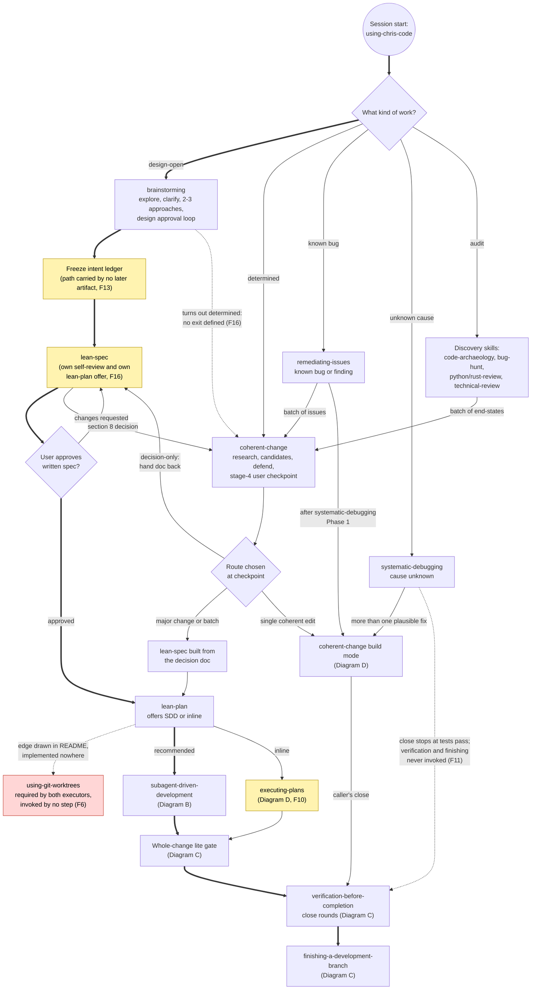
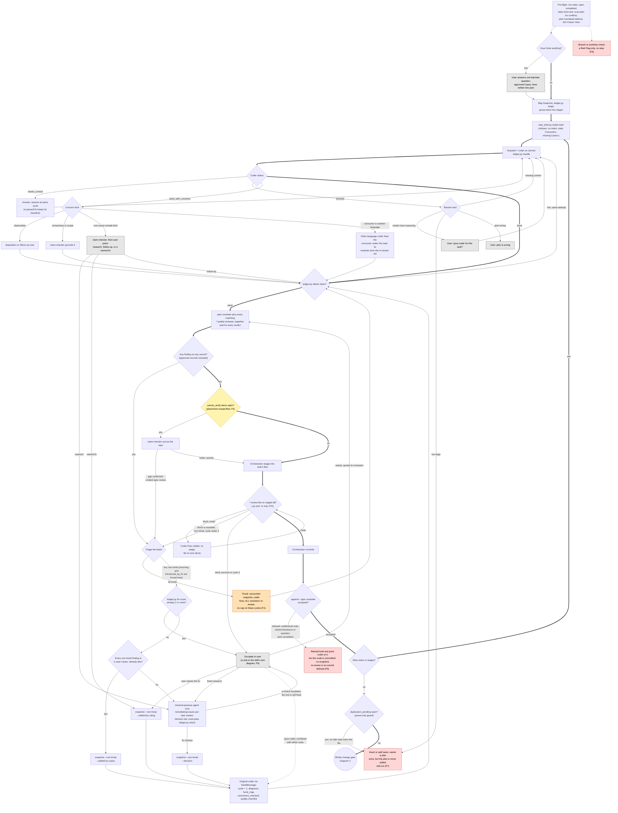
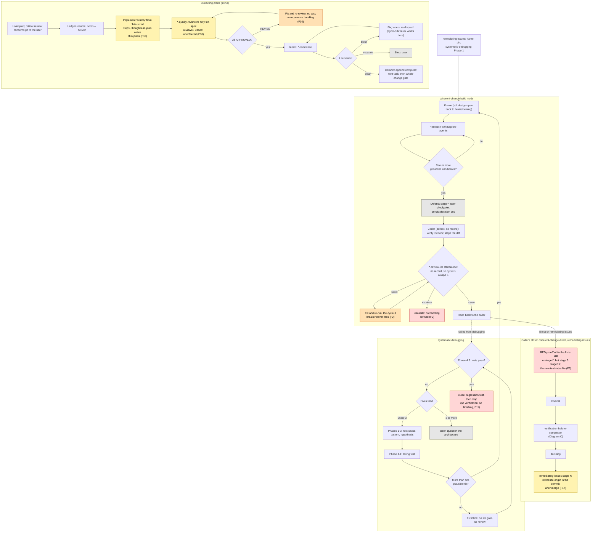

# chris-code SDD workflow: route map and review (2026-11-04)

Scope: every route from session start to `finishing-a-development-branch`, as described by the chris-code skills, agents, docs, and `ledger.py`. Findings come from reading those files. Nothing was executed; a claim about runtime behavior I inferred but did not run is marked **Unverified**. Everything else is Verified against the cited text.

Not covered: bug-hunt, test-sweep, release, writing-skills, and compaction/resume mechanics except where they affect routing.

**Path aliases used below** (all under `chris-code/`):

| Alias | File |
|---|---|
| SDD | `skills/subagent-driven-development/SKILL.md` |
| ledger | `skills/subagent-driven-development/scripts/ledger.py` |
| VBC | `skills/verification-before-completion/SKILL.md` |
| CC | `skills/coherent-change/SKILL.md` |
| RI | `skills/remediating-issues/SKILL.md` |
| EP | `skills/executing-plans/SKILL.md` |
| FIN | `skills/finishing-a-development-branch/SKILL.md` |
| WT | `skills/using-git-worktrees/SKILL.md` |
| SD | `skills/systematic-debugging/SKILL.md` |
| BS / LS / LP | `skills/brainstorming`, `skills/lean-spec`, `skills/lean-plan` (`SKILL.md`) |
| lite / coder / QR | `agents/python-review-lite.md`, `agents/python-coder.md`, `agents/python-quality-reviewer.md` (rust/pytorch twins match; checked by grep) |

## Legend

| Style | Meaning |
|---|---|
| thick arrow | main path |
| solid arrow | a route the skills define |
| dotted arrow | a route described only in prose, drawn in a doc but implemented nowhere, or left undefined |
| red node | broken: dead end, contradiction, or a step nothing invokes |
| orange node | loop with no cap or breaker |
| yellow node | inconsistency between skills |
| grey node | waits on the user |

`(Fn)` tags point to the findings table.

## A. End-to-end route map

## B. SDD per-task loop (every branch the prose defines)

The skill's own flowchart (SDD:28-87) shows about a third of this. Missing branches are drawn from the prose.

## C. Whole-change gate, close rounds, finishing

```mermaid
flowchart TB
    wcg["Whole-change lite gate:<br/>review-package BASE..HEAD,<br/>records final-*.json"]
    wcr{"Verdict"}
    wcfix["Fix at final-coder.json,<br/>snapshot --task final; re-review set<br/>and commit order undefined (F8)"]:::broken
    wcu["User"]:::human
    s12["Steps 1-2: full suite and lint<br/>(red: fix in place and commit,<br/>no gate, no cap, F4)"]:::uncapped
    debts["Settle open questions, disclosures,<br/>stranded task-notes"]
    cr1["ledger.py close-round --expect 1"]
    r1["Round 1, in parallel: design reviewers,<br/>intent-reviewer, mutation-tester<br/>(worktree); Step 4 meanwhile"]
    t1{"Triage once<br/>(five classes, F12)"}
    triv["Trivial: orchestrator fixes inline"]
    testonly["Mutation CONCERNS: coder<br/>writes a discriminating test"]
    canttell["can't-tell: re-dispatch<br/>intent-reviewer in the same round"]
    sep["Separable: follow-up note"]
    gate1["labels; *-review-lite; commit;<br/>re-run Steps 1-2"]
    j1{"Non-trivial set<br/>in round 1?"}
    rem["remediating-issues close-gate variant:<br/>coherent-change batch, one decision doc"]
    appr{"User approves at<br/>stage-4 checkpoint?"}
    apprno["Rejected: no route defined (F18)"]:::broken
    rplan["Log remediation note; lean-plan<br/>without lean-spec; task ids continue"]
    sdd2["SDD on the same store<br/>(Diagram B)"]
    wcg2["Whole-change gate,<br/>final-r2-* records"]
    s12b["Steps 1-2 again (F4)"]:::uncapped
    cr2["ledger.py close-round --expect 2"]
    r2["Round 2: design reviewers at same paths<br/>with remediation range; mutation on range;<br/>intent only if behavior changed"]
    t2{"Triage round 2"}
    gate2["labels; *-review-lite; commit;<br/>re-run Steps 1-2"]
    fu2["Outside the range: follow-up<br/>(S4+ escalates instead)"]
    remut{"Re-mutate a strengthened<br/>test once: PASS?"}
    remutno["Still CONCERNS:<br/>no route defined (F18)"]:::broken
    u2["User ruling; a third round<br/>is refused by ledger.py"]:::human
    rfix["Ruling fix: coder; labels; lite; commit;<br/>Steps 1-2 plus flagging gates, once"]
    done["ledger.py report;<br/>claim completion"]
    finpre["finishing Step 1 prerequisite<br/>('all six steps', F23)"]
    opt{"User picks option"}
    merge["Option 1: merge locally, then run<br/>tests on the merged result"]
    mfail["Tests fail after merge:<br/>no route defined (F14)"]:::broken
    cleanup["Report follow-ups; rm .sdd;<br/>git worktree remove (vs ExitWorktree<br/>in using-git-worktrees, F14)"]:::incon
    pr["Option 2: push and open PR;<br/>worktree kept"]
    keep["Option 3: keep as-is"]
    discard["Option 4: discard after typed confirm"]

    wcg ==> wcr
    wcr -->|"block or escalate"| wcfix --> wcg
    wcr -->|"block survives to cycle 3"| wcu
    wcr ==>|"clean"| s12
    s12 -->|"red"| s12
    s12 ==>|"green"| debts ==> cr1 ==> r1 ==> t1
    t1 -->|"trivial"| triv --> gate1
    t1 -->|"mutation CONCERNS"| testonly --> gate1
    t1 -->|"can't-tell"| canttell --> t1
    t1 -->|"separable"| sep --> j1
    t1 -->|"non-trivial"| j1
    gate1 --> j1
    t1 ==>|"nothing to fix"| done
    j1 -->|"yes"| rem
    j1 -->|"no"| remut
    rem --> appr
    appr -->|"no"| apprno
    appr -->|"yes"| rplan --> sdd2 --> wcg2 --> s12b
    s12b -->|"red"| s12b
    s12b -->|"green"| cr2 --> r2 --> t2
    t2 -->|"trivial or test-only"| gate2 --> remut
    t2 -->|"new, outside range"| fu2 --> done
    t2 -->|"non-trivial left,<br/>including recurring"| u2
    t2 -->|"clean"| done
    remut -->|"yes, or nothing to re-mutate"| done
    remut -->|"no"| remutno
    u2 -->|"fix it"| rfix
    rfix -->|"still flagged"| u2
    rfix -->|"cleared"| done
    u2 -->|"waive or accept"| done
    done ==> finpre ==> opt
    opt -->|"1"| merge
    merge -->|"fail"| mfail
    merge -->|"pass"| cleanup
    opt -->|"2"| pr
    opt -->|"3"| keep
    opt -->|"4"| discard --> cleanup

    classDef broken fill:#ffd6d6,stroke:#c0392b,color:#000
    classDef uncapped fill:#ffe0b3,stroke:#d35400,color:#000
    classDef incon fill:#fff3b0,stroke:#b7950b,color:#000
    classDef human fill:#e6e6e6,stroke:#555,color:#000
```

## D. The other build loops and front-end closes

## Fix-cycle inventory

The same fix loop exists at many places in the workflow, each with its own trigger, cap, and re-review scope. Most of the findings below are places where one loop never picked up a rule another loop already has.

| Loop | Trigger | Cap or breaker | Re-review per pass | Defined escape |
|---|---|---|---|---|
| SDD per task, trivial | any finding, including S1 on an approved record | none | every spec and quality reviewer | reviewers converge, or a recurrence forces it non-trivial |
| SDD per task, non-trivial | non-trivial finding | 2 fixes (`fix-count`, enforced in ledger) | every reviewer | user |
| SDD labels bounce | process label in added lines | none (deterministic, cheap) | none | coder rewrites |
| SDD per-task lite | S3+ or lint failure | lite cycle 3 (record-based) | trivial: lite only; non-trivial: spec + quality, then lite | user |
| SDD whole-change lite | S3+ across commits | lite cycle 3; `fix-count --task final` | undefined (F8) | user |
| executing-plans quality | REVISE | none | quality reviewers | none defined (F10) |
| executing-plans lite | S3+ or lint failure | lite cycle 3 | lite | user |
| coherent-change build lite | S3+ or lint failure | none: no record, so no cycle (F2) | lite | none defined |
| Verification Steps 1-2 | red suite or lint | none (F4) | none | none defined |
| Close rounds | design, intent, mutation findings | 2 rounds (enforced in ledger) | gates re-run on the remediation range | user |
| Post-round-2 ruling fix | user ruling | one re-check, then user | flagging gates | user |
| systematic-debugging | fix doesn't work | 3 attempts | tests | user (architecture) |
| Agent self-repair | own record fails `check` | none (F22) | n/a | none defined |

## Findings

### High

| ID | Type | Where | What goes wrong | Direction |
|---|---|---|---|---|
| F1 | Uncapped, repetitive loop | SDD:37, :196, :214, :216; ledger:1589-1606, :1727-1742 | Any finding on any record starts a fix, including an S1 note on an `approved` record. An all-trivial fix takes an uncounted snapshot, then every spec and quality reviewer (Opus) re-reviews. `fix-count` counts only non-trivial snapshots, and the skill says trivial leftovers never escalate. The loop ends only when the reviewers stop producing new nits, or when one recurs at the same site (then `snapshot` forces it non-trivial). Each pass re-samples the same models, so fresh S1/S2 notes are likely. The lite gate already uses a cheaper rule: a trivial lite fix re-runs only lite (:216). | Re-check trivial-only fixes cheaply (only the raising reviewer, on `diff-since`). Make S1-S2 notes on approved records optional (follow-up or disposition). Add a per-task ceiling on total reviewer cycles that escalates regardless of class. |
| F2 | Loop without escape | CC:80; lite:38, :70, :105 | Build mode dispatches `*-review-lite` without a record path. Lite then runs as a standalone gate: it writes no record and derives `cycle` = 1 on every dispatch, so its cycle-3 loop-breaker never fires. Stage 5 says only that the gate "must come back clean", with no cap and no handling for `escalate`. remediating-issues and systematic-debugging inherit this through build mode. | Give build mode a store record path (`store-dir` works in any repo), and route `escalate` to the user. |
| F3 | Contradictory steps | CC:80 vs :84; RI:56-58 | Stage 5 stages the fix so lite can read `git diff --cached`. The caller's close then requires the RED proof "while the fix is still unstaged", and warns that stashing after `git add` silently un-stages the fix. Followed in order, the steps produce exactly the failure the warning describes. The regression test written in the close is also committed without a lite pass, because lite ran before the test existed. | Write the durable test and run the RED proof before staging, then run one lite gate over the fix and the test together. |
| F4 | Ungated side door, uncapped | VBC:43, :54, :143; LP:114 | Red tests or lint at Steps 1-2 are "fixed in place" and committed with no `labels` check, no lite gate, no spec or quality review, and no cap. The orchestrator writes these fixes itself, after the whole-change gate. LP:114 names a likely cause (a task's narrow `Verify:` filter hiding a sibling failure), which can mean a behavior change. The close round's design, intent and mutation gates do see the result afterward, which partly mitigates this. | Route Step 1-2 failures through the close triage: trivial fixes go inline with lite, anything else goes to a coder fix through lite, with a small cap. |
| F5 | Broken re-entry | SDD:154, :184, :245, :256; coder:126; ledger:1299-1302 | The task commits first and calls `append --type complete` afterward. If complete refuses (a note filed after the brief, an owned disclosure or question, an open escalation), the skill says to rebuild the brief and point the coder at it, but the code is already committed. It doesn't say whether that pass is a fix (which needs a snapshot and a cycle bump, per coder:126), whether reviewers re-review, or how the second commit is gated. A confirmed `cannot_verify` gap ("send it back to the coder and re-review", :245) has the same problem, because the skill never places its resolution before the commit. | Check completion preconditions before staging, for example a `ledger.py ready --task N` that runs complete's checks plus open `cannot_verify` items. A refusal then lands while the task is still in the review loop. |
| F6 | Required step never invoked | SDD:374, :401; EP:86, :91; WT:45; README:176 | Both executors list `using-git-worktrees` as required, but no step in brainstorming, lean-plan, SDD pre-flight or EP Step 1 invokes it. The README diagram draws plan → worktree → SDD, and no skill implements that edge. "Never start on main without consent" is only a Red Flag. If the user declines a worktree, WT works in place and creates no branch. | Make the branch/worktree check step 0 of SDD pre-flight and EP Step 1, or of lean-plan's handoff. |

### Medium

| ID | Type | Where | What goes wrong | Direction |
|---|---|---|---|---|
| F7 | Broken path | SDD:124, :148, :162, :165, :281, :390; docs/explanation/execution-mechanics.md:51 | The skill tells you to insert tasks: a hoist task for an unowned `duplication_pending`, or smaller tasks for a BLOCKED task that's too large. `task_brief.py` builds a brief only from a task entry in the plan file. The skill also says the plan is never edited mid-run and a brief is never built by hand. An inserted task has no sanctioned way to get a brief. | Sanction an append-only "Inserted tasks" section in the plan, or let `task_brief.py` read an inserted entry from the store. |
| F8 | Under-specified loop | SDD:296-298 | A whole-change block is fixed "exactly as at a per-commit gate", but the skill leaves two things open. (a) Do spec and quality reviewers re-review a non-trivial final fix? The per-commit rule says yes (:216), yet `final` has no brief for the spec reviewer. (b) How does the fix reach the next review? The gate reads a package of committed `BASE..HEAD`, so an uncommitted fix is invisible to it, while committing first means committing past a blocked gate. | State the order: per-commit lite on the fix's staged diff, commit, regenerate the package, re-run the whole-change lite at the same record path. Name the re-review set. |
| F9 | Diagram fidelity | SDD:28-87 vs :209, :215, :245, :256, :267-284, :385 | The skill's own flowchart draws escalation as a sink, with no return edges for a ruled fix, a fresh decision, a waiver, or an opus coder. It draws "can't be fixed as asked" as an alternative to the fix, though :215 fixes the rest of the batch meanwhile. It omits DONE_WITH_CONCERNS, the `root cause:` user choice, NEEDS_CONTEXT/BLOCKED, the escalated-consumer route, `cannot_verify`, completion refusals, and the `duplication_pending` guard. An orchestrator skimming the diagram misses most decision points. | Regenerate it from the prose (Diagram B is a starting point). |
| F10 | Weak path, inconsistent | EP:3, :28, :30; LP:10, :128; QR:14; agents/spec-reviewer.md:46 | The inline path's REVISE → fix → re-review loop has no cap, no recurrence signal, and no decision doc. With no spec reviewer, nothing checks that each `Cases:` case has a test. With no `task_brief.py`, `Cases:` is unenforced. EP says "follow each step exactly (plan has bite-sized steps)", but LP writes thin what/where plans. EP's description says "in a separate session"; LP offers it as "execute in this session". QR expects brief and report paths, but EP hands it the plan's task entry. | Align EP with SDD's gates, or label it in LP's offer as the reduced-assurance path. |
| F11 | Broken close | SD:166-178, :247; CC:82-88; docs/explanation/the-pipeline.md:49 | When debugging hands the fix to coherent-change, build mode returns it saying the caller owns the close (durable coverage, verification-before-completion, finishing). SD's close is "the failing test, regression coverage, verify". Its "verify" is Phase 4.3 (tests pass); verification-before-completion appears only under Related skills, and finishing appears nowhere. The pipeline doc diagram shows debug → engine → full close, which SD doesn't do. The single-plausible-fix branch also implements with no lite gate. | Make SD's Phase 4 close name verification-before-completion and finishing, as RI stage 3 does. |
| F12 | Inconsistent authority | SDD:197-201, :215, :237; VBC:148-153; skills/receiving-code-review/SKILL.md:37, :103-113 | Per task, triage has two classes, grounding "never overturns the reviewer's call", and only a re-review or the user can close a finding. At the close, triage has five classes, the orchestrator may file a finding as "separable" on its own call, and it must "verify each finding is real" through receiving-code-review, which tells it to push back. The same S3 finding is binding at task level and dismissible at the close. | One authority model and one triage taxonomy, referenced from both. |
| F13 | Missing link | BS:118; LP:36-87; task_brief.py:593-596; SDD:149; VBC:99-104, :155 | brainstorming writes the intent ledger, but neither the spec nor the plan format records its path. `--intent` is free text from the orchestrator's memory. In a fresh session (EP is described for one), SDD briefs and VBC Step 5 find the ledger only by naming convention. The only artifact that records the path is the close-gate remediation note (VBC:155). | Add the intent ledger path to LP §2 (or a header), and have `task_brief.py` quote it. |
| F14 | Dead end, inconsistent | FIN:89-96, :182-189; WT:51, :62 | Option 1 merges into the base branch, then runs tests "on the merged result", with no route if they fail (the base is already merged locally). Cleanup runs `git worktree remove` on `.claude/worktrees/` paths, which is where EnterWorktree puts them. WT says to leave those with ExitWorktree, and that `cd` in bash doesn't move the session. Unverified: removing the worktree the session is rooted in likely breaks later tool calls. | Add a test-failure branch (undo the merge, or stop and report), and use ExitWorktree for harness-created worktrees. |
| F15 | Prose-only guard | SDD:384; ledger:1299-1302; docs/explanation/execution-mechanics.md:86 | The Red Flag says a task is never completed with an open `cannot_verify`, an unresolved status, an escalation, or a malformed record. `complete` checks only escalations and notes. That breaks the run's own principle that controls rest "on evidence, not discipline". | Extend complete's checks, or fold them into the `ready` check from F5. |

### Low

| ID | Type | Where | What goes wrong | Direction |
|---|---|---|---|---|
| F16 | Inconsistent handoff | BS:31-34, :38-67, :69; LS:111-125; CC:34 | BS says lean-plan is the only skill invoked after it, yet step 8 invokes lean-spec. lean-spec then runs its own self-review and its own "ready for lean-plan?" offer while BS still owes a self-review and the user's spec review, so the user gets two next-step prompts. If exploration shows the work is determined, BS has no exit to coherent-change, though CC expects that return. The BS flowchart omits the readiness check and the spec commit. | Have lean-spec skip its handoff when BS called it; add a determined-work exit; update the flowchart. |
| F17 | Ordering | RI:60, :62 | RI records the origin (stage 4, "reference in the commit") after finishing (stage 3.3), when the commit is already merged or pushed. | Reference the origin before committing; close the issue after finishing. |
| F18 | Dead ends | VBC:155, :166 | (a) The user rejects the close-gate decision doc at CC's stage-4 checkpoint: no route. (b) The one-shot re-mutation of a strengthened test still returns CONCERNS: no route. | Send both to the user explicitly, or add them to the round-2 escalation set. |
| F19 | Inconsistent | SDD:12 vs :24, :214-215, :219, :269, :280 | "The only reasons to stop" lists three, but the skill defines at least six other pauses for the user: the pre-flight question, the fix-cap escalation, the can't-fix escalation, a plan-mandated defect, a root cause, and the opus offer. | List them, or reword to "stop only where this skill names a user decision". |
| F20 | Inconsistent | SDD:113-114, :205 | The model table pins the remediating-issues research agent to Opus, but its dispatch says only "a general-purpose agent". With no model given, general-purpose inherits the parent's model. The implementer fallback states `model: sonnet` explicitly. | Put `model: opus` in the research dispatch. |
| F21 | Coverage gap | `agents/*` scope lines; SDD:93-105 | `.ipynb` gets a coder and quality reviewers but no lite gate (python-review-lite is `.py` only). Any other language gets a general-purpose coder and the spec reviewer, with no quality, lite or design reviewer. Nothing says whether an empty gate passes. | State the no-match rule: pass with a disposition note, or require the user's OK. |
| F22 | Loop without escape | RI:101-103; every record-writing agent's "re-run until it exits 0" | `ledger.py findings` can report a malformed or misfiled record, written by another agent, that blocks the decision. The research agent is told to fix its own record until `check` passes, then return, and has no "blocked" return for a failure it can't fix. | Allow a blocked return that names the blocking record. |
| F23 | Doc drift | README:166-200; FIN:20; VBC:115, :123; CC:85, :110; lite:133; WT step numbers | The README diagram has the plan → worktree edge and omits executing-plans, the whole-change gate, and the remediation loop. FIN requires "all six steps" to pass, though VBC skips Step 5 with no ledger and Step 6 for docs-only changes. CC summarizes verification as tests, lint and design review only. lite calls `.claude/output/review-lite/` gitignored, but nothing ignores it, and BS commits `.claude/output/specs/`. WT jumps from Step 1 to Step 3. | Batch-fix. |
