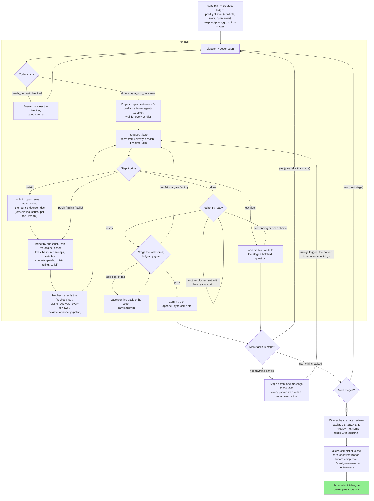

# Subagent-Driven Development

Execute plan by dispatching fresh subagent per task. After each, the spec and quality reviewers review together, `ledger.py triage` routes their tagged findings, and a scripted gate checks the staged files before the commit.

**Core principle:** Specialized coder agent per task → spec + quality review in parallel → triage → at most two fix rounds → gate → commit. Fresh context per task, staged parallelism for independent tasks.

**Continuous execution:** Do not pause between tasks. Stop only where this skill names a user decision: the pre-flight question, a stage's batched question, an unresolvable BLOCKED, or all tasks complete.

**Every task gets every gate.** Review, triage, and the commit gate apply to ALL tasks, not just the first one. You will feel pressure to skip gates on later tasks because "the pattern is established" or "this one is simple." That impulse is the exact failure mode this rule prevents. Task 5 gets the same gates as Task 1. No exceptions.

## Pre-Flight Plan Review

Before dispatching Task 1, load the progress ledger (see Durable Progress). Clear it first if it belongs to a finished run (the test is in Durable Progress), then resume at the first task not marked complete. Then read the plan once and check for:

- **Internal conflicts** — tasks that contradict each other or the plan's Constraints.
- **Plan-mandated defects** — anything the plan asks for that a reviewer would flag (a test that asserts nothing, verbatim duplication, a swallowed error).
- **Missing or thin `Cases:` lines** — each row must state its result (`size=0 → ValueError`), and `task_brief.py` refuses a row that doesn't, a missing line, and a task whose `Verify:` line has no backticked command. A row written as a principle ("validate sizes") ships one reading of it at a time. Plans written before this rule need rows; propose them and ask.
- **`open:` rows** — behavior the planner couldn't decide. `task_brief.py` refuses a task that still has one, so batch every `open:` row into the same question.

Write every approved answer into the plan file: `task_brief.py` reads the plan, so an approval that stays in conversation still fails the brief.

Present everything you find to the user as one batched question, each finding beside the plan text that mandates it, asking which governs. If the scan is clean, proceed without comment. Do not interrupt per-discovery mid-run.

## The Process



**The loop in one paragraph.** Reviewers tag every finding with `severity`, `reach`, `rule`, and `sites`, and `triage` turns them into a step. S1-S2 findings are notes, fixed or skipped by the coder and never re-reviewed, except S1-S2 contract-reach ones, which are deferred to the close. S3+ local or class findings get a patch round. S3+ contract findings and `root cause:` concerns get a holistic round, where an opus research agent writes one task-wide decision doc first. A task gets at most two patch or holistic rounds. After that, open work escalates to the stage's batched question. Contested findings go back to the reviewer who raised them, and a held one waits for the user too. Nothing here asks you to judge whether a finding is trivial: the tags decide, and `ledger.py` enforces what each round must show.

## Agent Selection

### Coder Agents (exclusive — one coder per task)

Dispatch the most specific `*-coder` agent for the task's file types:

1. Check which file types the task will touch
2. Match against available `*-coder` agents by `scope.extensions`
3. If multiple match the same extension, resolve via `scope.require_dependencies` — most specific wins (e.g., `pytorch-coder` over `python-coder` when project depends on torch)
4. Concrete tiebreaker: if the code subclasses `nn.Module`, manipulates `torch.Tensor` shapes/devices, or implements a training-pipeline component (loss, callback, optimizer, scheduler, metric), dispatch `pytorch-coder`. Reserve `python-coder` for non-torch code (CLI, data I/O, config utils).
5. If no specific coder matches, fall back to a general-purpose agent

Only one coder agent writes the code. The one exception is an escalated consumer in another language during a fix (see *Route an escalated consumer*), where that language's coder changes only the consumer. The winning coder must be self-contained (includes both domain-specific and general language patterns).

### Review Agents (additive — all matching agents fire)

Unlike coders, `*-quality-reviewer` and `*-review-lite` agents are **additive**: all agents matching the file extensions fire on the same diff. In a PyTorch project, `.py` files get both `python-quality-reviewer` (general Python patterns) and `pytorch-quality-reviewer` (Lightning conventions, training correctness). If findings conflict, the more specific agent's guidance takes precedence.

### Model Selection

Each role has a fixed model, pinned in the agent's frontmatter. **Pass no `model` when dispatching a chris-code agent**, and announce the model and agent on every dispatch: "Dispatching sonnet rust-coder agent for Task 5 (refactor pipeline)".

| Model | Roles |
|-------|-------|
| **Sonnet** | Coders (`*-coder`, and `general-purpose` used as an implementer, which takes `model: sonnet`), `*-review-lite` |
| **Opus** | Spec, quality and design reviewers, `intent-reviewer`, `mutation-tester`, `bug-hunter`, the `remediating-issues` research agent |
| **Haiku** | `claim-checker` |

Design judgment lives in the decision doc and the brief, so a coder implements choices that are already made. Coders never run above sonnet on your judgment, holistic rounds included. **The one exception is the user's ruling.** A task escalated to the stage batch can be ruled onto an opus coder, and the user can also ask for one at any time. When the user rules an opus coder for a task, log it with `ledger.py append --type progress --task N --note "user ruling: opus coder <the ruling, verbatim>"`. Then dispatch that task's coder with `model: opus` and a `Model: opus` line in the dispatch that quotes the ruling. A coder checks its own model first and returns `needs_context` without changing anything when it runs above sonnet without that line, and `ledger.py check` refuses a finished coder record on any model but sonnet unless the ruling is logged for its task.

## Task Scheduling

Use **staged parallelism**, not flat sequential or flat parallel dispatch.

1. **Map file footprints:** Before dispatching, identify every source file and test file each task will touch
2. **Group into stages:** Tasks within a stage must have zero file overlap (source AND test files). Tasks that share any file go in separate stages. Record each task's stage and footprint with `python3 "$SDD_SCRIPTS/ledger.py" stage --task N --stage K --files <paths> --store "$STORE"`, which refuses a path another unfinished task in the same stage already claims. Re-issue it when a task is inserted or a footprint grows, so the map in `run-state` stays the one you schedule by. An inserted task takes the next whole number after the highest task id (Task 7, not Task 3a): briefs and the ledger track tasks by number.
3. **Within a stage:** Dispatch subagents in parallel — they touch disjoint files and cannot conflict
4. **Between stages:** Wait for every task in the current stage to commit or park. If any parked, send the stage batch (see *Park, then ask once per stage*) and finish those tasks before starting the next stage

Common serialization triggers:
- Two tasks both modify the same test file (e.g., `conftest.py`, `test_utils.py`)
- Two tasks both touch a shared module (e.g., `models.py`, `lib.rs`)
- A later task depends on types/interfaces introduced by an earlier task

When in doubt, serialize. The cost of a conflict is higher than the cost of waiting.

## File Handoffs

Anything you paste into a dispatch — and anything a subagent prints back — stays resident in your context for the rest of the session. Hand artifacts over as files instead, all under one resolved store directory, per-worktree and uncommitted. Resolve it **once**, at the start of the session, and reuse it everywhere.

First pin where this skill's scripts live. A session runs from the user's project, but the scripts live at the plugin install path, so a repo-relative `scripts/…` resolves against the wrong directory. When the skill loads, Claude Code prints a "Base directory for this skill: …" line. `SDD_SCRIPTS` is that directory plus `/scripts`, as an absolute path, and every script call below goes through it:

```
SDD_SCRIPTS=<this skill's base directory>/scripts
STORE=$(python3 "$SDD_SCRIPTS/ledger.py" store-dir)
```

`ledger.py store-dir` is the single authority for the store location, and skills reference it instead of restating the derivation: the default is `.sdd/` at the repo toplevel (`git rev-parse --show-toplevel`), which resolves per-worktree — each linked worktree gets its own store — and lives in the working tree, never under `.git/`. `store-dir` also creates the directory and seeds a `.gitignore` containing `*` inside it, so the store ignores itself and its contents never show up as untracked, with no edit to the repo's own ignore rules. Agents are forbidden from computing their own paths (see below), so the path you hand them must come from this one call. Pass `--store "$STORE"` on every `ledger.py`/`task_brief.py` call this session (except `ledger.py diff-since` and `ledger.py labels`, which read the working tree and take no `--store`), and build every record path as `$STORE/task-N-<agent-name>.json`. To relocate the store (rarely needed), override via `STORE=$(python3 "$SDD_SCRIPTS/ledger.py" store-dir --store DIR)`, then use it identically everywhere; every subcommand except `diff-since` and `labels` accepts `--store DIR`. One caveat of an in-tree store: `git clean -fdx` deletes it — don't run that mid-plan.

- **Task brief:** the brief is a *reference sheet*, not a restatement of the spec. From the repo root (it resolves `Consumes:` paths against the current directory), assemble it with `python3 "$SDD_SCRIPTS/task_brief.py" PLAN_FILE N --intent "..." [--spec SPEC_FILE] [--constraints-from PLAN_FILE] --store "$STORE" -o "$STORE/task-N-brief.md"` (`--spec` is required only when the task entry contains a §-ref) — the script extracts the plan's task entry (its actions, `Consumes:` pointers, and spec §-references), embeds the intent and the task's notes from the store (its task-notes, every active run-note, and the disclosures it owes; see Run Notes), logs their delivery, copies the plan's Constraints verbatim when `--constraints-from` is given, and always appends the shared-shapes section (see Cross-Task Pattern Ledger). It fails loudly — non-zero exit, no file written — on a missing/empty `--intent`, a stale `Consumes:` pointer, a missing or placeholder `Cases:` line, a row that states no result, an unanswered `open:` row, a `Verify:` line without a command, or a task `Rigor:` line below the project level; fix the plan or the intent rather than routing around the failure. Every brief opens with the task's `Rigor: <level> (<reasons>)` line from `scripts/rigor.py`, and the coder and every reviewer apply their row of `rigor.md` at that level. A dispatch never restates or lowers it. The dispatch carries: (1) one line on where this task fits **and the observable outcome it must produce — the *why* (see Intent below)**; (2) the brief path, introduced as "read this first — your task and the sections to read"; (3) the spec path, where the coder reads the referenced §§; for a contract built by an earlier task, name the file or spec § rather than restating its signature; (4) the Global Constraints copied verbatim; (5) the report-file path; (6) the record path — `$STORE/task-N-<agent-name>.json`, or `$STORE/final-<agent-name>.json` at the whole-change gate, which has no task number (see Whole-Change Gate); (7) the scripts path — `$SDD_SCRIPTS`, expanded to its absolute value (a subagent doesn't inherit your shell variables), which every record-writing agent needs to run `ledger.py check` on its own record before returning.
- **Intent (the *why*) — required:** a coder recovers *what* and *where* by reading the brief, the spec, and the repo, but it cannot recover *why* — the observable outcome this task serves. A fresh subagent does not inherit your conversation, so the brief is intent's only channel: the dispatch must carry it — one or two lines on the outcome this task must produce, quoting the relevant intent-ledger statement where one exists. Hand over the goal, not just the change — a coder given only *what* and *where* optimizes the diff and can ship the wrong thing correctly. If you cannot state the why, the task isn't ready to dispatch (the intent lives only in your head — externalize it or keep the task in-session).
- **Cross-task notes (orchestrator-only, terse):** beyond intent (above), the other thing the coder cannot recover by reading the spec and the repo is cross-task context. File it as a task-note for the task that needs it (`ledger.py note --kind task-note --for N --from M --text "..."`, see Run Notes), and `task_brief.py` carries it into that task's brief. Write pointers and decisions, never dereferenced spec content: a dependency contract (`built in Task M → path`), a conflict adjudication (`finding §5 governs the extent→band call`), a code entry point (the landing symbol, plus any new wire-key value), or a shared-shape pointer from the pattern ledger (see Cross-Task Pattern Ledger). Grounding beyond the entry point is the coder's job (its first step is to read the files it will touch), so point at the entry and let it trace the chain. Keep this to a few lines; if it grows, the requirement belongs in the spec, or the conflict belonged in the Pre-Flight Plan Review.
- **Report file:** name it after the brief (`task-N-brief.md` → `task-N-report.md`). The implementer writes its full report there and returns only status, the changed-file list, a one-line test summary, and concerns. This bullet is not the whole closing instruction: the same dispatch must also carry the record path and the scripts path (elements 6 and 7 above) — a dispatch that ends at "write your report and return the summary" produces no typed record, and the agent cannot self-supply the path it was never given.
- **Reviewer inputs:** spec-reviewer and `*-quality-reviewer` agents get the brief path, the report path, the changed-file list, the verbatim Constraints, the record path, the coder's record path, and the scripts path, and read the actual changed files. A re-check also gets the round's kind and the `Fix baseline: <tree>` with the task's file list (for `ledger.py diff-since`), and the task's settled finding ids from the last triage entry's `settled`. The coder's record carries its contests, decision doc, and sweeps, so the reviewer reads those there. Do not paste diffs.
- **Review-lite inputs:** `*-review-lite` agents run only at the whole-change gate. They get the review-package file path, the verbatim Constraints, the task (`"final"`), the record path, and the scripts path. No brief path, no report path, no changed-file list: they review exactly the diff they're handed (see Whole-Change Gate). A re-check also gets the coder's record path and the scope's settled ids from the last triage entry.
- **Staging and committing a task (you own both).** Coders never stage or commit. When triage says `done`, run `python3 "$SDD_SCRIPTS/ledger.py" ready --task N --store "$STORE"`: it lists everything that still stops the commit (a held finding, an open behavior choice, an undelivered note, an open `cannot_verify`, a malformed record, and at `final` an open escalation). When it passes, stage exactly the task's files (`git add <task files>`, never `git add -A`, since parallel tasks share the working tree) and run `python3 "$SDD_SCRIPTS/ledger.py" gate --task N --test "<the task's Verify: command>" [--lint "<the project's lint command>"] --store "$STORE"`. It refuses while a task file has unstaged changes. At `final`, `--test` is the project's full test suite. A labels or lint failure goes back to the coder as the same attempt; a failing test becomes a gate finding, so run `triage` again. When it passes, commit, then `append --type complete --task N --note "commits <base7>..<head7>"`, which re-runs `ready` and checks the commit matches what the gate passed.
- **Never** paste task text, prior-task summaries, or diffs into a dispatch or into your own context. A fresh subagent needs its brief, the interfaces it touches, and the constraints — nothing else.

## Cross-Task Pattern Ledger

You are the only actor who sees the task sequence — briefs carry intent and contracts, coders are scope-disciplined against out-of-task refactoring, reviewers see one diff. Cross-task shape tracking is therefore yours to act on, though the record-keeping itself is now automatic: coders declare `new_shared_symbols` and `duplication_pending` in their typed record (see the coder agent's Typed record section) instead of a prose sentinel, and `ledger.py shapes` derives the shared-shapes list from those records on the fly. Untracked, a shape repeated across tasks still lands as N verbatim copies that every per-task gate passes — the typing removes the "forgot to note it" failure, not the need to act on what's noted.

- **Shapes carry automatically:** every brief `task_brief.py` produces includes the shared-shapes section unconditionally (no flag disables it), so no manual append step is needed to populate it. If a later same-family task needs the pointer called out more directly than the brief's list does, file a task-note for it: "the composite dispatch lives at `<symbol>`; call it, don't re-inline."
- **On a `duplication_pending` entry** — visible via `python3 "$SDD_SCRIPTS/ledger.py" open --store "$STORE"` or read straight off a coder's record — assign the hoist to the next task whose footprint covers the owning file, or append a small hoist task if none does. Don't let it ride to the whole-change gate — by then the copies are committed and the fix is rework across N commits. Once the hoist lands, run `python3 "$SDD_SCRIPTS/ledger.py" resolve <id> --note "..." --store "$STORE"` so it stops appearing in `open` — `<id>` is content-derived (a digest of the entry, e.g. `task-1-python-coder#duplication_pending[a1b2c3d4]`), not a positional index, so copy it verbatim from `open`'s output rather than constructing it by hand; a rewritten record whose entry changes gets a new id even at the same field.
- **`ledger.py shapes` is incomplete while any `#malformed` item is open in `ledger.py open`.** A record that fails to parse or fails validation is skipped by `shapes` entirely, so its `new_shared_symbols` (and its `duplication_pending`) stay invisible until the writing agent fixes it with `ledger.py check`. Don't trust `shapes` as complete while `open` still lists a malformed record.

- **Unlisted cases feed forward.** A coder that handles a case its brief's `Cases:` line didn't list reports it as a `concerns` entry starting `unlisted case:`. That is a planning gap, not a problem with the task, so it doesn't make the task's status a concern to investigate. When a later task covers the same kind of rule (the same parameter shape, or the same validation applied elsewhere), file the case as a task-note for that task. `ledger.py report` lists every unlisted case from the coder records, beside the follow-ups, for the completion report (`verification-before-completion`, *After Verification Passes*). Never edit the plan mid-run: this is how its gaps surface instead.

## Run Notes

You hold the run's cross-task knowledge, and it lives in the store, not in your context or a file of your own. File every piece of it as a typed note with `python3 "$SDD_SCRIPTS/ledger.py" note --kind KIND --text "..." [--for N] [--owner N|close] [--from N|final|run] --store "$STORE"`, which prints the note's id. Briefs, gates, `run-state` and `report` read only the store, so a note kept anywhere else reaches no coder, blocks nothing, and is lost at the next compaction.

| Kind | File it when | It reaches | It ends when |
|---|---|---|---|
| `task-note` (`--for N`) | a later task needs a pointer, a decision, an unlisted case, or a hoist assignment | task N's brief | task N completes, or you `resolve` it as superseded |
| `run-note` | a rule holds for every task from now on (a test recipe, a process rule, a standing user ruling quoted verbatim) | every brief, and every task already in flight | you `resolve` it as retired |
| `disclosure` (`--owner N\|close`) | the shipped docs owe something: a changelog line, a spec amendment, a reversed contract | the owner task's brief, or the close round | you `resolve` it with the file and commit where it landed |
| `question` (`--owner N\|close`) | something waits on the user but not now: a golden to bless, a call to raise at the close | `run-state` and `open`; you ask the user | you `resolve` it with `user ruling: <their answer, verbatim>` |
| `follow-up` (`--rule TEXT` optional) | a separable improvement, a pre-existing defect, a root cause the user deferred. `triage` files the loop's own deferrals itself, with their rule: S1-S2 contract-reach findings, notes a coder skipped, and sites a sweep found outside the task | `report`, grouped by rule for the close batch | a later task fixes it (`resolve`); otherwise it stays open in the store after the completion report lists it, so a later `clear` asks the user first |
| `disposition` | you made a judgment call without the user: proceeding past a concern, choosing between readings of a ruling | `report` | never; it is the audit trail of your calls |
| `checkpoint` | before a pause, before `/compact`, and after the user changes course: what the store can't show (staged files, an interrupted agent, the next steps) | `run-state`, newest only | the next checkpoint |

- **Only you (and `triage`) file notes.** Subagents report cross-task items in their records (`concerns`, `duplication_pending`, `cannot_verify`, a north-star a decision doc's defense defers), and you decide what to file. `triage` files the deferrals the records already decide: an outside site a later task's footprint covers becomes a task-note for that task, and the rest become follow-ups.
- **One note, one kind.** A changelog debt that a later task also needs to know about is a disclosure owned by that task, not a task-note.
- **Log every ruling once.** A ruling that answers a question or an escalation goes in that item's `resolve --note "user ruling: ..."`. Log any other ruling with `append --type progress --note "user ruling: ..."` on its task, or on `--task run` for one about the whole run. `report` lists both kinds. A ruling that sets a standing rule is also filed as a run-note quoting it.
- **Delivery is checked.** `ready` and `append --type complete` refuse while the task has a note filed after its brief was built, or an open disclosure or question it owns. Run `triage` first, which sees the undelivered note and returns polish; then rebuild the brief (it logs the delivery) and dispatch the polish with it. Rebuilding first would mark the note delivered before any coder saw it. A note that doesn't apply to an in-flight task can be waived: `ledger.py notes --task N --waive <id> --reason "..."`. The waiver appears in `report` with your dispositions. A waiver covers delivery only: a disclosure or question the task owns still has to be resolved before `complete`.
- **The close checks debts too.** `close-round` refuses while any disclosure or question is open, or a task-note still waits on a task that never completed.
- **An existing free-form notes file.** If the store already holds one from before this rule (an `orchestrator-notes.md`, say), read it once at the start, file its live items as typed notes, and append nothing more to it.

## Global Constraints

Copy the plan's Constraints section verbatim (exact values, formats, and stated relationships between components) into every implementer and reviewer dispatch. It is the reviewer's attention lens for what THIS project demands; the process rules already live in the agents and templates. This duplicates the Constraints section `task_brief.py --constraints-from` already writes into a coder's brief — deliberately, not paste-creep: the brief's copy is what the coder reads first, from its reference sheet; the dispatch's copy is what a reviewer's or the fallback template's primary framing sees immediately, without depending on whether it opened the brief for that purpose.

## Constructing Reviewer Dispatches

- **Never pre-judge.** Do not instruct a reviewer to ignore, not-flag, or pre-rate a finding. If your dispatch contains "do not flag," "at most Minor," or "the plan chose," stop — you are pre-judging to spare yourself a review loop. Let the reviewer raise it and adjudicate it in the loop.
- **Hand findings over by path, never by paraphrase.** The fix dispatch carries the reviewers' record paths (and report paths, where the contract writes one) and does not restate the findings; the coder reads its round's findings from `ledger.py baseline` and each one in the reviewer's own words rather than in yours. Restating is where a finding quietly loses its severity, its `file:line`, or its reasoning — the hub corrupting the review signal is exactly what typed records exist to prevent.
- **Dispatch the spec reviewer and every matching `*-quality-reviewer` together, and never dispatch a fix while any of them is still out.** Accumulate every verdict first, then triage once and send one fix dispatch carrying every reviewer's record path. A fix dispatched against a partial verdict set buys one guaranteed extra round when the late reviewer's findings land. A re-check is different: it re-dispatches only the set triage names.
- **Run `triage`; it decides the step.** Once every verdict is in, run `python3 "$SDD_SCRIPTS/ledger.py" triage --task N --store "$STORE"`. It reads the reviewers' tagged findings and the coder's record, logs a triage entry, files the deferrals, and prints the step, its findings (id, tier, rule, the reviewer that raised it), who re-checks it, the settled ids to hand the re-check, the decision doc a holistic round writes, and a re-stage-and-gate line when a gate finding was sent. Run it again after every re-check and every gate failure. Running it with nothing changed reprints the last step and starts nothing. Don't sort findings into trivial and non-trivial yourself, and don't re-rate a tag: the reviewers' severity and reach route the fix, and only a re-check or the user closes a finding. The steps:
  - **patch**: the original coder fixes the batch. Each finding's rule is swept across the task's files, each S3+ finding gets a failing test first, and notes ride along.
  - **holistic**: research first. Dispatch a general-purpose agent with `model: opus` and tell it to invoke `chris-code:remediating-issues` (per-task variant) with the Skill tool. Give it the reviewer record paths, the coder's record path, the brief path, the task's file list, the scripts path (`$SDD_SCRIPTS`, expanded), the store path, the verbatim Constraints, and the output path `triage` names (`$STORE/<scope>-decision-c<cycle>.json`). It writes one task-wide decision doc that accounts for every open finding and `root cause:` concern, runs `ledger.py check` on it until it passes, and returns the path. Then the original coder implements it case by case. A finding the doc escalates isn't yours to carry to the user: the coder contests it with the doc's evidence, and the raising reviewer concedes or holds it in the round's re-check. Don't write the doc yourself: your memory of the run is not research.
  - **ruling**: the coder implements the user's ruling, quoted verbatim in the dispatch. A ruling round that sent no finding implements an overridden open choice, and the spec reviewer re-checks it.
  - **polish**: the coder fixes or skips the open notes, or applies a rebuilt brief. Nobody re-checks it; run `triage` again when it returns.
  - **escalate**: park the task (see *Park, then ask once per stage*).
  - **done**: go to the commit path (`ready`, then `gate`).
- **Record a fix baseline after triage, before every fix.** Run `python3 "$SDD_SCRIPTS/ledger.py" snapshot --task N --label "pre-fix c<cycle>" --store "$STORE"` and pass `Fix baseline: <tree>` and the task's file list to the coder and to every re-checking reviewer. The coder reads its round with `ledger.py baseline`, and `check` holds the finished fix to that round. A fix that paused with `needs_context` or `blocked` and is resuming is the same fix: re-send its original baseline, since a new snapshot would absorb its partial edits. Each fix gets its own snapshot; `check` refuses a fix whose baseline an earlier cycle used.
- **Re-check exactly the `recheck` set, at the reviewers' same record paths.** `raising` is the reviewers whose S3+ findings the round sent (the entry's `recheck_records`), over the fix diff and its consumers. `all` is every reviewer, over the whole task. `spec` (an override's ruling round) is the spec reviewer alone. `gate` means run `gate` again. `none` (a polish) means nobody. A gate finding is never re-dispatched: when the round sent one, re-stage the task's files and re-run `gate` after the fix. Re-dispatching a reviewer whose findings weren't sent re-reads approved code into fresh nits, which is the churn this loop exists to stop. Every re-check gets the round's kind and the task's settled ids. A reviewer the coder contested answers each contest in its record (`concede` or `hold`), and `check` refuses a re-check that leaves one unanswered.
- **Attach the review checklist to a patch, holistic, or ruling fix.** The fix dispatch carries the checklist it will be judged by: every matching quality reviewer's contract, at `$SDD_SCRIPTS/../../../agents/<name>-quality-reviewer.md` (expanded to absolute; both python and pytorch in a PyTorch project). A polish skips it.
- **Route an escalated consumer.** A coder that finds a fix breaks a consumer it can't change itself (another language) returns `done_with_concerns` naming the consumer. Dispatch that language's coder for the consumer, as part of this task's fix, with the parent task's brief, the coder's concern naming the consumer, the fix baseline and the task's file list (now including the consumer's file), and the scripts path. Give it its own record path (`$STORE/task-N-<agent-name>.json`) and report path, starting at cycle 1. Add its quality reviewer to the re-check set and tell every re-checking reviewer which files it changed. A public-API change is a contract change: the coder records `reach_raised`, and the next triage routes it.
- **Send the fix to the original coder when you can.** If the agent that implemented the task is still reachable, continue it with `SendMessage` instead of dispatching a fresh one. It keeps the reasoning and invariants it built while implementing, and losing those is how a cold fixer breaks things the reviewers had approved. Record every coder's agent id when you dispatch it (`ledger.py handle --task N --role <agent-name> --agent <id> --store "$STORE"`), so after a compaction `run-state` still names the agent to continue. An id works only in the session that created it. Fall back to a fresh dispatch at the same record path when the agent isn't reachable. Either way, the coder's record path and cycle derivation are the same.
- **Fix dispatches re-point at the same record path.** The coder reads its own prior record there and self-derives `cycle` as prior + 1. From cycle 2 its record carries a `diagnosis`, a `hunk_map`, and `consumers_checked`, plus the round's evidence (sweep rows mapped to hunks, tests first, contests, skipped notes, decision rows), all enforced by `check`.
- **Park, then ask once per stage.** A task parks when triage escalates (open work after two fix rounds, or a held contest), or when `ready` lists an open behavior choice (an unplanned contract change is recorded as one). The other `ready` blockers (a note, `cannot_verify`, a malformed record) are yours to settle, not the user's. A parked task doesn't commit; the rest of the stage keeps going. `run-state` lists every parked item. Once no task in the stage has a dispatch in flight, send the user one message covering all of them:
  - each task's open findings (rule, sites), with the holistic decision's choice and rejected alternatives where one ran
  - the round history, with each round's closed and introduced counts (`ledger.py stats`)
  - each open behavior choice with the coder's default and its precedent, flagging `no precedent` ones as design calls
  - any `root cause:` concern still open after the task's rounds, which the user can waive to let the task land
  - a recommended answer for every item, so one reply ("accept all", or overrides by number) settles the batch

  A task coming back after a failed ruling round always offers "land as-is and file the rest as follow-ups" next to another ruling; recommend it when the last round introduced as many findings as it closed. Log each answer: an accepted choice, a waived finding, and a waived root cause with `resolve <id> --note "user ruling: ..."`; an overridden choice with both `append --type progress --task N --note "user ruling: override <id>: <the behavior>"` and `resolve <id> --note "user ruling: override ..."`; a ruled fix with `append --type progress --task N --note "user ruling: ..."`. Then run `triage` for each parked task: a ruling starts a ruling round (an override starts one even from `done`), and waivers drop their findings.
- **A reviewer finding closes only by a re-check or by the user.** Never close one by your own ruling, and never accept code untested that a reviewer or the brief's `Cases:` line asked to be tested; that waiver is the user's to give. `cannot_verify` and `duplication_pending` items keep their own rules: you resolve those with `ledger.py resolve`, as described below.
- **Never narrow the mandate.** Do not reframe a reviewer's job to a subset of its remit ("just check for bugs," "only look at the parser," "skip the tests"). Each reviewer's system prompt defines its full scope — hand it the inputs and constraints, not a reduced charter. Under-cueing the scope is as corrosive as suppressing a finding: a design reviewer told to "look for bugs" stops reviewing design.
- **Do not** ask a reviewer to re-run tests the implementer already ran, or add open-ended directives ("check all uses") without a concrete, task-specific reason.
- **Plan-mandated defects are the user's call.** A coder that finds a finding conflicts with the plan contests it (`plan-conflict`); a reviewer that holds it sends it to the stage batch with the plan text beside it. Do not dismiss it because the plan mandated it, and do not dispatch a fix that contradicts the plan without asking.

## Judging from Compressed Reports

Everything a subagent hands back is a *compression*: a coder's report, a reviewer's verdict, a one-line status. You decide what to integrate from these compressions, one step removed from the evidence. The doers carry anti-over-trust discipline aimed at them ("Do Not Trust the Report"); you are the one seam where no one points that discipline back at *your* inputs. Apply it yourself.

Most of what you act on no longer needs your judgment: a reviewer's findings route by their tags through `triage`, a coder's disagreement goes back to the reviewer as a contest, and `check` holds each record to the evidence its round requires. What's left for you are claims nobody in the loop can settle by reading one diff:

- **Fact-shaped** — did the task complete? did the gate pass? Trust the ledger; re-running them is the gate's job, not yours.
- **Judgment-shaped, outside one diff** — a spec reviewer's `cannot_verify` item, whose answer lives in unchanged code or across tasks. **Do not resolve it on the label alone.**

**Ground by dispatch, not by reading.** You do not need to open the changed code — that would cost you the very context this skill spends its file handoffs protecting. What you need is to turn the item into a **decidable claim**:

> "`process_data` now takes 8 parameters, 4 of them mode flags" — decidable by reading.
> "This will be hard to maintain" — not decidable; that is a judgment to adjudicate, not a claim to check.

Dispatch `claim-checker` with one claim, the file and line range, and nothing else — no verdict text, no reviewer reasoning, so it cannot anchor on the conclusion it is checking. It returns `holds` / `does-not-hold` / `not-decidable-by-reading` plus 3 to 10 verbatim lines. **The evidence is mandatory**: a bare verdict word would be one more laundering channel. Because what comes back is quotation rather than conclusion, it needs no grounding of its own, and the chain stops there. One claim per dispatch.

When a claim comes back `not-decidable-by-reading`, or the evidence spans tasks and no single range settles it, **escalate with the evidence attached**, not with the summary. Hand the user (or the next dispatch) the actual lines and the conflicting claims, not your paraphrase.

And before you dispatch: **don't hand a subagent context you've only externalized in your head.** If a task's "why" lives only in this conversation and not in the brief, the spec, or the ledger, the fresh agent will reconstruct it wrong. Either get it into the brief (`--intent`, or a task-note per Run Notes) or keep the task in-session. A fresh dispatch is the right tool only when its context is recoverable from artifacts.

## Handling ⚠️ Items

The spec-reviewer's "⚠️ Cannot verify from diff" line is typed: each item lands in its record's `cannot_verify` field (see spec-reviewer's Typed record) and surfaces in `python3 "$SDD_SCRIPTS/ledger.py" open --store "$STORE"`, keyed as `<record-stem>#cannot_verify[<digest>]` — content-derived from the entry, not a positional index, so copy the id verbatim from `open`'s output when resolving rather than constructing it by hand. These do not block the rest of the review, but resolve each one before marking the task complete: you hold the plan and cross-task context the reviewer lacks. The reviewer could not settle these because its scope was one diff, so resolve them at the scope it lacked: this is the judgment-shaped case from *Judging from Compressed Reports* — state the requirement as a decidable claim and dispatch `claim-checker` across the whole repo rather than the diff; don't act on the ⚠️ label or the `open` summary alone, and don't read the code yourself to do it. Once grounded, run `python3 "$SDD_SCRIPTS/ledger.py" resolve <id> --note "..." --store "$STORE"` so it stops appearing in `open`. A confirmed gap goes back to the spec reviewer with the claim-checker's evidence, and the reviewer raises it as a tagged finding; then run `triage`. Never write a finding yourself. `ready` blocks the commit while any `cannot_verify` item is open, so ground them before the task's last triage.

## Durable Progress

Conversation memory does not survive compaction; a controller that loses its place can re-dispatch finished tasks. Track progress in the typed store, not only in TodoWrite.

- At start:
  - **Resume.** Run `python3 "$SDD_SCRIPTS/ledger.py" run-state --store "$STORE"` for where the run stands (stages and task states, each task's rounds, what's parked for the user, notes owed, open disclosures and questions, agent handles, the latest checkpoint), `python3 "$SDD_SCRIPTS/ledger.py" read --store "$STORE"` for the full store as markdown, `python3 "$SDD_SCRIPTS/ledger.py" open --store "$STORE"` for what's still unresolved, and `python3 "$SDD_SCRIPTS/ledger.py" completed --store "$STORE"` for which task ids are done. A task id listed by `completed` is DONE — do not re-dispatch it, even if `open` still lists a `duplication_pending` entry for it; the Pattern Ledger deliberately carries that forward as assigned work for a later task, not as evidence this one is unfinished (see Cross-Task Pattern Ledger and Red Flags). Any *other* open item on a completed task — `cannot_verify`, a malformed record — means the completion was premature; treat it as unfinished and investigate before resuming past it. A reviewer record whose status still reads `issues` or `block` is not one by itself: its findings may be waived or conceded, which `complete` already checked. Resume at the first task id `completed` does not list.
  - **A stale store.** If the store belongs to a different branch or a stale run, `python3 "$SDD_SCRIPTS/ledger.py" clear --store "$STORE"` first. `clear` refuses while the old run's follow-ups, disclosures or questions are open: show the user `ledger.py report`, and pass `--discard-open` only once they confirm those can go.
  - **A close-gate remediation run.** A close-gate remediation plan (see `chris-code:verification-before-completion`, *The Close Round*) is the same run, not a stale one: never clear its store, since that would erase the finished tasks and the close-round count. You can recognize one in `ledger.py read`: a `close round 1` entry, then a `close-gate remediation r1: plan <path>, …` note naming **the plan you were handed**, and no `close round 2` yet. Then resume that plan, and when its last task completes, the next steps are the whole-change gate (with `final-r2-*` records) and then verification's round 2 (`close-round --expect 2`), followed by the front-end the note names. A store whose close rounds belong to any other plan is a finished run, and so is one that already has round 2. Clear it before starting, or `completed` will skip your new plan's tasks as done. One case is ambiguous: round 1 with no round 2 and no remediation note at all. That can be a close interrupted (say, by compaction) before its note was written, so ask the user before clearing it.
  - **A malformed log.** A malformed `progress.jsonl` line stops every command that reads the log loudly (the error names the file and line): fix that line, or, if the user confirms the log is disposable, `clear --discard-open`. `append --type progress`, `handle`, `shapes`, `store-dir`, `findings`, `labels`, `diff-since`, and `snapshot` keep working meanwhile.
- When the task commits, run `python3 "$SDD_SCRIPTS/ledger.py" append --type complete --task N --note "commits <base7>..<head7>" --store "$STORE"` alongside marking it done in TodoWrite. It refuses with every `ready` blocker listed, and when the commit doesn't match what the last passing gate checked. An escalation in a close-gate decision doc is closed by its own `resolve <id> --note "user ruling: ..."`, not a progress note; a task's decision escalations go through the contest instead. TodoWrite is your live view; the store — and `ledger.py completed` specifically — is the durable recovery map, a typed entry rather than a prose substring to pattern-match.
- Records are overwritten each cycle, so every passing `ledger.py check` also appends a summary line to `history.jsonl` in the store. `python3 "$SDD_SCRIPTS/ledger.py" stats --store "$STORE"` prints each task's verdicts cycle by cycle, each triage round with the coder model and the findings it closed, saw survive, and saw a fix introduce, and the tests-first `n/a` counts by category. Use it for the stage batch's round history, and include it in the completion report.
- After compaction, re-pin `SDD_SCRIPTS` and re-resolve `$STORE` (see File Handoffs), since neither survives compaction. If the "Base directory for this skill" line is gone from context, reload this skill to get it back. Then read `ledger.py run-state --store "$STORE"` first, rebuild the TodoWrite list from it, `ledger.py open --store "$STORE"`, and `ledger.py completed --store "$STORE"`, and trust them and `git log` over your own recollection — `open` also surfaces anything left unresolved before the compaction hit (a `duplication_pending` entry, a `cannot_verify` item, an undelivered note), not just task completion.
- File a `checkpoint` note at each pause point (see Run Notes); `run-state` shows the newest one, so a resume never reconstructs it from memory.

## Handling Implementer Status

Implementer subagents report one of four statuses. Handle each appropriately:

**DONE:** Dispatch the spec + quality review. Process labels in comments are caught mechanically: `check` refuses a finished fix that adds one, and the gate catches a first attempt's before the commit.

**DONE_WITH_CONCERNS:** The implementer completed the work but flagged doubts. (An `unlisted case:` or `label false positive:` entry alone is informational: see *Unlisted cases feed forward*.) Read the concerns before proceeding. A doubt about correctness or scope goes to the reviewers: dispatch the review as usual, and they judge it. An observation ("this file is getting large") needs nothing; file a `disposition` note for any call you made in deciding so (a separable improvement worth keeping goes in a `follow-up`). A cross-language consumer goes through *Route an escalated consumer*.

**A root cause outside the brief.** A coder that traces a problem to code its brief doesn't cover (the task's change exposes it, or depends on it) reports it as a `concerns` entry `root cause: <path> <evidence>`. Don't send the coder back to fix it, and don't ask the user yet: `triage` routes it to a holistic round, where the research agent decides whether this task fixes it or files it, with evidence. A decision that lists it in `excluded` defers it: `triage` files it as a follow-up with the reason and stops counting it. A root cause the task can't wait for goes to the stage batch, where the user can waive it. Each fix can expose the next root cause, and each takes a round of the task's two, so a task that keeps growing reaches the stage batch with its history.

**Open behavior choices.** Behavior the brief left undefined isn't a stop: the coder follows the nearest precedent in the codebase and records it in `open`, as it does a contract change the plan didn't specify. `ready` parks the task until the user accepts or overrides each in the stage batch.

**NEEDS_CONTEXT:** The implementer needs information that wasn't provided. Provide the missing context and re-dispatch. A fix that paused this way resumes with its original `Fix baseline` and task file list, not a new snapshot.

**BLOCKED:** The implementer cannot complete the task. Assess the blocker:
1. If it's a context problem, provide more context and re-dispatch with the same model
2. If the task requires more reasoning, offer the user an opus coder for it (coders go above sonnet only under their ruling, see *Model Selection*)
3. If the task is too large, break it into smaller pieces
4. If the plan itself is wrong, escalate to the human

A fix that was blocked and is re-dispatched (cases 1–2) resumes with its original `Fix baseline` and task file list, not a new snapshot, exactly like a NEEDS_CONTEXT resume.

**Never** ignore an escalation or force the same model to retry without changes. If the implementer said it's stuck, something needs to change.

## Whole-Change Gate (lite, not the completion gate)

After the last stage, run one review over the whole change. Each task's reviewers saw one task in isolation, so cross-task drift (a helper duplicated across two tasks, an inconsistency between Task 1 and Task 5) can pass every task and still land.

The task commits are already in, so hand `*-review-lite` the whole-change diff as a file:

1. `BASE=$(git merge-base HEAD <base-branch>)`, `HEAD=$(git rev-parse HEAD)`.
2. Run `"$SDD_SCRIPTS/review-package" "$BASE" "$HEAD" "$STORE/review-whole-change.diff"` — it writes the commit list, stat, and full multi-commit diff to that file and prints the path (the diff never enters your context). Pass the explicit `$STORE` outfile: the script's own default resolves the session-independent default store, which is the wrong location when the session overrode `--store`.
3. Dispatch each matching `*-review-lite` agent with that package-file path, a record path at `$STORE/final-<agent-name>.json` (`"task": "final"`; in a close-gate remediation run use `$STORE/final-r2-<agent-name>.json`, so the agent doesn't inherit the original run's cycle), and the scripts path.

Then it's the same loop with `--task final`: `triage --task final` routes lite's tagged findings (lite tags a finding on a public symbol `contract`), at most two fix rounds, then the user. A fix here has no task: dispatch the language-matched coder at `$STORE/final-<coder-name>.json` (`final-r2-…` in a remediation run), take the snapshot with `--task final`, and a holistic round's decision doc goes where `triage` names. Each fix goes through `gate --task final --test "<the project's full test suite>"` on its staged files and is committed before the re-check. Lite then re-checks at its same record path, with the coder's record path and the settled ids, over a package of just the fix commit after a patch, or the full `BASE..HEAD` package after a holistic round. Open `duplication_pending` items block `ready --task final`.

**This gate is necessary, not sufficient.** It is the diff-level idiom check applied across commits; it doesn't exercise behavior or assess architecture. After it passes, the caller still owes the heavyweight close: `chris-code:verification-before-completion` (the `*-design-reviewer` cohesion gate, the `intent-reviewer` spec-blind behavior check, and the close batch over the run's follow-ups), then `chris-code:finishing-a-development-branch`. A green suite plus a passing lite gate is not "verified": a green suite proves the assertions you wrote pass, not that behavior is correct or the design coheres. The close is mandatory either way: a front-end (`coherent-change`, `remediating-issues`) owns it if one drove SDD; on direct invocation you do. Being the caller is not an exemption. In a close-gate remediation run, that close *is* verification's round 2: invoke it once, not once for SDD and again for the front-end.

## Prompt Templates

- `./implementer-prompt.md` - Dispatch implementer subagent (used when no `*-coder` agent matches)

Spec compliance review is handled by the registered `spec-reviewer` agent (read-only on the checkout aside from its own typed record, language-agnostic — see Typed record in spec-reviewer.md) — dispatch it explicitly per task; it carries its own mandate (do-not-trust-the-report, instruction precedence), so no prompt template is needed. Quality review is handled by `*-quality-reviewer` agents (e.g., `python-quality-reviewer`, `rust-quality-reviewer`), dispatched by scope matching.

All dispatches use file handoffs (see File Handoffs): pass brief, report, record, and scripts paths plus verbatim Constraints, never pasted task text or diffs.

## Example Workflow

```
[Read plan: .claude/output/plans/feature-plan.md]
[Pin the scripts: SDD_SCRIPTS=<base directory from the skill-load header>/scripts]
[Resolve the store once: STORE=$(python3 "$SDD_SCRIPTS/ledger.py" store-dir)]
[python3 "$SDD_SCRIPTS/ledger.py" run-state --store "$STORE" + read + open + completed → empty store, start at Task 1]
[Pre-flight: Task 4 has an `open: what does size=None do?` row → one batched question → the
  user's answer is written into the plan as `size=None → ValueError`]
[Extract 5 tasks, map file footprints, group into 3 stages]
[Stage 1: Tasks 1,2 (disjoint files) | Stage 2: Task 3 | Stage 3: Tasks 4,5 (disjoint)]
[python3 "$SDD_SCRIPTS/ledger.py" stage --task 1 --stage 1 --files src/cli.py tests/test_cli.py tests/conftest.py --store "$STORE", and the same for Tasks 2–5]

Stage 1 — dispatching 2 tasks in parallel:
  [task_brief.py feature-plan.md 1 … -o "$STORE/task-1-brief.md", and the same for Task 2]
  "Dispatching sonnet python-coder agent for Task 1 (add CLI hook)"
  "Dispatching sonnet python-coder agent for Task 2 (add utility function)"
  [ledger.py handle --task 1 --role python-coder --agent <id>, and the same for Task 2]

  Task 1: coder done (duplication_pending: 1 site; open: empty --name → default "cli",
    precedent src/config.py:12) → spec ✅ + quality ❌ (S3 local: hidden side effect, at 2 sites)
    → `triage --task 1` → patch, recheck raising
    → snapshot → coder sweeps the rule (2 rows), writes the failing test first, fixes
    → quality re-checks the fix diff ✅ → `triage` → done
    → `ready --task 1` → parked: the open choice waits for the stage batch
  Task 2: coder done → spec ✅ + quality ✅ (one S1 note) → `triage` → polish
    → coder fixes the note → `triage` → done → `ready` ✅ → stage → `gate --task 2
    --test "pytest tests/test_util.py"` ✅ → commit → `append --type complete --task 2`

  [Stage batch: "Task 1 chose `cli` as the default name, as src/config.py:12 does.
    Recommended: accept." → user: "accept all" → `resolve <choice id> --note "user ruling:
    accept"` → `ready --task 1` ✅ → gate → commit → complete]
  [ledger.py open → task-1-python-coder#duplication_pending[a1b2c3d4]; Task 3 owns the file:
   note --kind task-note --for 3 --from 1 --text "hoist the helper task 1 flagged"]

Stage 2:
  Task 3: coder hoists the helper (new_shared_symbols: 1) → reviews flag an S3 contract
    finding (the hoist renames a public function) → `triage` → holistic, recheck all
    → opus research agent writes $STORE/task-3-decision-c2.json → snapshot → coder
    implements it case by case → every reviewer re-checks ✅ → `triage` → done → ready
    → gate → commit → `resolve task-1-python-coder#duplication_pending[a1b2c3d4]
    --note "hoisted in Task 3"` → complete

Stage 3 — dispatching 2 tasks in parallel:
  "Dispatching sonnet rust-coder agent for Task 4 (add FFI binding)"
  "Dispatching sonnet python-coder agent for Task 5 (add Python wrapper)"
  [Both: review → triage → done → ready → gate → commit → complete]

[Whole-change gate: review-package base..HEAD → python-review-lite + rust-review-lite
  → `triage --task final` → done]
[Caller's completion close: chris-code:verification-before-completion → *-design-reviewer
  + intent-reviewer, then the close batch over the run's follow-ups]
[chris-code:finishing-a-development-branch]
```

## Red Flags

- Never start implementation on main/master without explicit user consent
- Never skip reviews (spec compliance OR quality) or commit with open work, unless the user waived it (a logged `user ruling:`)
- Never dispatch subagents in parallel when their file footprints overlap
- Never paste task text or diffs into a dispatch or your own context — hand the task brief as a file (`python3 "$SDD_SCRIPTS/task_brief.py"`), and never hand a subagent the whole plan file
- Never coach a reviewer to suppress, soften, or pre-rate a finding (quoting a logged user ruling verbatim is not coaching)
- Never dispatch a fix before every spec and quality verdict for the task is in
- Never decide a step yourself: run `triage` and make the dispatch it prints. Never re-rate a finding's tags, sort findings into trivial and non-trivial, or close one on your own call
- Never re-check with more reviewers than `recheck` names, or fewer (the one addition: an escalated consumer's quality reviewer, see *Route an escalated consumer*)
- Never write a decision doc yourself; a holistic round's doc comes from the opus research agent
- Never send a coder back to fix a `root cause:` outside its brief on your own call: triage routes it
- Never ask the user about a parked task mid-stage: batch every parked item into one message once the stage has nothing in flight, each with a recommendation
- Never dispatch a fresh fixer when the original coder is still reachable by `SendMessage`, and never send a fix without a `snapshot` taken after its triage entry
- Never commit a task without `ready` passing and a passing `gate` on exactly the staged task files; `complete` refuses a commit that doesn't match the gate
- Never pass `--light` on an SDD task: it is executing-plans' path, and `ready` refuses it on a task the triage loop runs
- Never enter the whole-change gate with an open `duplication_pending` entry in `ledger.py open`: resolve it (the hoist landed) or reassign it to a task still ahead first
- Never re-dispatch a task `ledger.py completed` lists
- Never keep cross-task state in a file of your own (an `orchestrator-notes.md`, a scratch list): it reaches no brief, gates nothing, and is lost to the next compaction. File it as a note (see Run Notes)
- Never pause, hand off, or `/compact` without a `checkpoint` note for what the store can't show
- Never hand a fix an earlier cycle's baseline: `check` refuses it
- Never construct a dispatch brief by hand when `task_brief.py` can produce it — a hand-assembled brief skips `Consumes:` validation, the `Cases:` and `Verify:` checks, and the shared-shapes section
- Never construct a resolution id by hand — ids are content-derived (a digest of the entry), not positional, so copy them verbatim from `ledger.py open`, `triage`, or `run-state`
- Never pass a `cycle` value in a dispatch — agents self-derive `cycle` from their own prior record at the same record path
- Never let a subagent compute its own record or scripts path — the dispatch supplies both, exactly as it supplies the report path
- If a subagent is blocked: provide more context, offer the user an opus coder (see *Model Selection*), or break the task apart — never force retry without changes

## Integration

**Required workflow skills:**
- **chris-code:using-git-worktrees** - Ensures isolated workspace
- **chris-code:lean-plan** - Creates the plan this skill executes
- **chris-code:requesting-code-review** - Ad-hoc reviews outside these gates (the gate reviewers are registered agents and need no template)
- **chris-code:finishing-a-development-branch** - Complete development after all tasks

**Agents:**
- **`*-coder` agents** - Specialized implementers, auto-dispatched by file type
- **`spec-reviewer`** - Read-only spec-compliance gate aside from its own typed record, dispatched explicitly per task (language-agnostic)
- **`*-quality-reviewer` agents** - Design quality + bug detection review, auto-dispatched by file type
- **`*-review-lite` agents** - The whole-change gate (idiom + lint across commits), auto-dispatched by file type

**Subagents should use:**
- **chris-code:test-driven-development** - Subagents follow TDD for each task

**Alternative workflow:**
- **chris-code:executing-plans** - Use for inline execution without subagents
