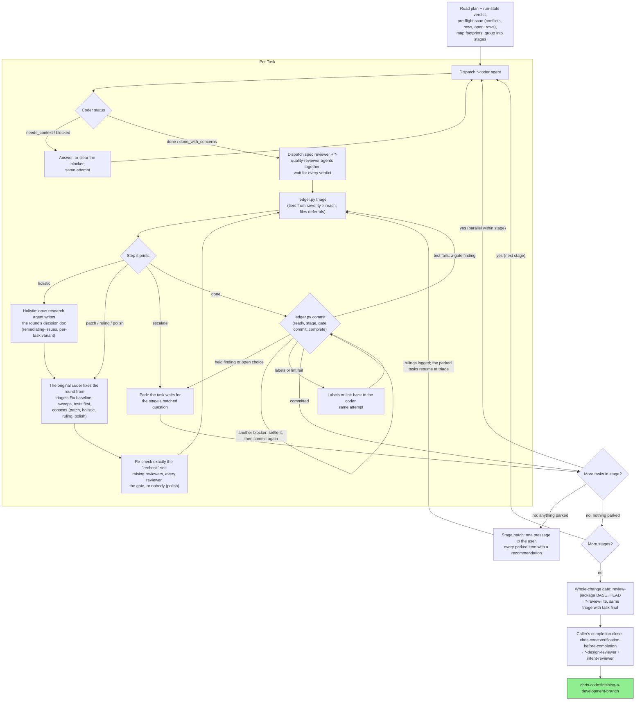

# Subagent-Driven Development

Execute a plan by dispatching a fresh coder subagent per task. After each task the spec and quality reviewers review together, `ledger.py triage` routes their tagged findings, and a scripted gate checks the staged files before the commit.

**Core principle:** one specialized coder per task → spec and quality review in parallel → triage → at most two fix rounds → gate → commit. Fresh context per task; staged parallelism for independent tasks.

**Continuous execution.** Don't pause between tasks. Stop only where this skill names a user decision: the pre-flight question, a stage's batched question, an unresolvable BLOCKED, or all tasks complete.

**Every task gets every gate.** Review, triage and the commit gate apply to every task. The pressure to skip them on a later task because "the pattern is established" or "this one is simple" is the failure this rule exists for. Task 5 gets the same gates as Task 1.

## Pre-Flight Plan Review

Before Task 1, run `run-state --plan` and follow its verdict (*Durable Progress*). Read the plan once and look for:

- **Internal conflicts:** tasks that contradict each other or the plan's Constraints.
- **Plan-mandated defects:** anything the plan asks for that a reviewer would flag (a test that asserts nothing, verbatim duplication, a swallowed error).
- **Missing or thin `Cases:` lines.** Each row states its result (`size=0 → ValueError`); a row written as a principle ("validate sizes") ships one reading of it at a time. `task_brief.py` refuses a missing line, a row with no result, and a task whose `Verify:` line has no backticked command. For a plan written before this rule, propose rows and ask.
- **`open:` rows:** behavior the planner couldn't decide. `task_brief.py` refuses a task that still has one.

Put everything you find to the user as one batched question, each finding beside the plan text that mandates it, asking which governs. Write every answer into the plan file: `task_brief.py` reads the plan, so an approval left in conversation still fails the brief. A clean scan proceeds without comment. Don't interrupt mid-run per discovery.

## The Process



**The loop in one paragraph.** Reviewers tag every finding with `severity`, `reach`, `rule` and `sites`, and `triage` turns them into a step. S1-S2 findings are notes the coder fixes or skips, never re-reviewed; S1-S2 findings of contract reach are deferred to the close instead. S3+ local or class findings get a patch round. S3+ contract findings and `root cause:` concerns get a holistic round, where an opus research agent first writes one task-wide decision doc. A task gets at most two patch or holistic rounds; after that, open work escalates to the stage's batched question. A contested finding goes back to the reviewer who raised it, and a held one waits for the user too. You never judge whether a finding is trivial: the tags decide, and `ledger.py` enforces what each round must show.

## Agent Selection

### Coder Agents (exclusive — one coder per task)

Dispatch the most specific `*-coder` for the task's file types:

1. Match the file types the task touches against each coder's `scope.extensions`.
2. When several match, the most specific `scope.require_dependencies` wins (`pytorch-coder` over `python-coder` when the project depends on torch). Tiebreaker: code that subclasses `nn.Module`, manipulates `torch.Tensor` shapes or devices, or implements a training-pipeline component (loss, callback, optimizer, scheduler, metric) goes to `pytorch-coder`; non-torch code (CLI, data I/O, config utils) goes to `python-coder`.
3. With no specific match, fall back to a general-purpose agent.

One coder writes the task's code, and it is self-contained (domain-specific and general language patterns). The only exception is an escalated consumer in another language during a fix (*Route an escalated consumer*), where that language's coder changes only the consumer.

### Review Agents (additive — all matching agents fire)

Every `*-quality-reviewer` and `*-review-lite` agent matching the changed extensions reviews the same diff. In a PyTorch project, `.py` files get both `python-quality-reviewer` (general Python) and `pytorch-quality-reviewer` (Lightning conventions, training correctness). Where findings conflict, the more specific agent wins.

### Model Selection

Each role runs on the model pinned in its agent's frontmatter. **Pass no `model` when dispatching a chris-code agent**, and announce the model and agent on every dispatch: "Dispatching sonnet rust-coder agent for Task 5 (refactor pipeline)".

| Model | Roles |
|-------|-------|
| **Sonnet** | Coders (`*-coder`, and `general-purpose` used as an implementer, which takes `model: sonnet`), `*-review-lite` |
| **Opus** | Spec, quality and design reviewers, `intent-reviewer`, `mutation-tester`, `bug-hunter`, the `remediating-issues` research agent |
| **Haiku** | `claim-checker` |

Design judgment lives in the decision doc and the brief, so coders implement choices already made and never run above sonnet on your judgment, holistic rounds included. **The one exception is the user's ruling**, offered when a task reaches the stage batch or asked for at any time. Log it with `ledger.py append --type progress --task N --note "user ruling: opus coder <the ruling, verbatim>"`, then dispatch that task's coder with `model: opus` and a `Model: opus` line quoting the ruling. A coder running above sonnet without that line returns `needs_context` without changing anything, and `ledger.py check` refuses a finished coder record on any model but sonnet unless the ruling is logged for its task.

## Task Scheduling

Use **staged parallelism**:

1. **Map file footprints:** every source and test file each task will touch.
2. **Group into stages:** tasks in a stage share no file, source or test. Record each task with `python3 "$SDD_SCRIPTS/ledger.py" stage --task N --stage K --files <paths> --store "$STORE"`, which refuses a path another unfinished task in the same stage claims. Re-issue it when a task is inserted or a footprint grows, so `run-state` shows the map you schedule by. An inserted task takes the next whole number after the highest task id (Task 7, not Task 3a): briefs and the ledger track tasks by number.
3. **Within a stage,** dispatch in parallel.
4. **Between stages,** wait until every task in the stage commits or parks. If any parked, send the stage batch (*Park, then ask once per stage*) and finish those tasks before the next stage.

Serialize when two tasks modify the same test file (`conftest.py`, `test_utils.py`) or shared module (`models.py`, `lib.rs`), or when a later task depends on types or interfaces an earlier one introduces. When in doubt, serialize: a conflict costs more than waiting.

## File Handoffs

Anything you paste into a dispatch, and anything a subagent prints back, stays in your context for the rest of the session. Hand artifacts over as files in one store directory, resolved once at the start of the session.

The scripts live at the plugin install path, not in the user's project, so a repo-relative `scripts/…` resolves against the wrong directory. When this skill loads, Claude Code prints a "Base directory for this skill: …" line. `SDD_SCRIPTS` is that directory plus `/scripts`, absolute, and every script call goes through it:

```
SDD_SCRIPTS=<this skill's base directory>/scripts
STORE=$(python3 "$SDD_SCRIPTS/ledger.py" store-dir)
```

`ledger.py store-dir` is the single authority for the store location. By default it is `.sdd/` at the repo toplevel, so each linked worktree gets its own, in the working tree and never under `.git/`. It creates the directory with a `.gitignore` of `*`, so the store never shows as untracked. Agents never compute paths, so every path you hand them comes from this one call. Pass `--store "$STORE"` on every `ledger.py` and `task_brief.py` call except `ledger.py diff-since` and `labels`, which read the working tree and take none. Take every record, report and brief path from `ledger.py path --task N|final|close|ruling|gate [--agent NAME] [--kind record|report|brief]`, which follows the store's naming (`final-r2-` records once a close round has started, and so on); never build one by hand. To relocate the store, use `STORE=$(python3 "$SDD_SCRIPTS/ledger.py" store-dir --store DIR)` and pass it the same way everywhere. `git clean -fdx` deletes the store: don't run it mid-plan.

- **Task brief.** The brief is a reference sheet, not a restatement of the spec. Build it from the repo root, since `Consumes:` paths and the rigor level resolve against the current directory: `python3 "$SDD_SCRIPTS/task_brief.py" PLAN_FILE N --intent "..." [--spec SPEC_FILE] [--constraints-from PLAN_FILE] --store "$STORE" -o <path --task N --kind brief>` (`--spec` only when the task entry has a §-ref). It extracts the task's plan entry (actions, `Consumes:` pointers, spec §-refs), opens with the task's `Rigor: <level> (<reasons>)` line, embeds the intent and the task's notes from the store (its task-notes, every active run-note, the disclosures it owes) and logs their delivery, copies the plan's Constraints when given `--constraints-from`, always appends the shared-shapes section, and records the plan in the store for `run-state`. It writes nothing and exits non-zero on a missing intent, a stale `Consumes:` pointer, a missing or placeholder `Cases:` line, a row with no result, an `open:` row, a `Verify:` line without a command, or a `Rigor:` line below the project level. Fix the plan or the intent; never route around it. The coder and every reviewer apply their row of `rigor.md` at the brief's level, and a dispatch never restates or lowers it.
- **The coder dispatch carries:** (1) one line on where the task fits and the observable outcome it must produce (*Intent*, below); (2) the brief path, introduced as "read this first — your task and the sections to read"; (3) the spec path, for the referenced §§ (for a contract an earlier task built, name the file or spec §, never restate its signature); (4) the Global Constraints, verbatim; (5) its report path (`path --task N --agent <coder> --kind report`); (6) its record path (`path --task N --agent <coder>`, or `--task final` at the whole-change gate); (7) the scripts path, `$SDD_SCRIPTS` expanded to its absolute value, since a subagent doesn't inherit your shell variables and every record-writing agent runs `ledger.py check` on its own record. The coder writes its full report to the report path and returns only its status, the changed files, a one-line test summary and its concerns. Without (6) and (7) there is no typed record: an agent can't supply a path it was never given.
- **Intent (the *why*) is required.** A coder recovers *what* and *where* from the brief, the spec and the repo, but never *why*. State in one or two lines the outcome the task must produce, quoting the intent-ledger statement where one exists. A coder given only what and where optimizes the diff and can ship the wrong thing correctly. If you can't state the why, the task isn't ready: externalize it, or keep the task in-session.
- **Cross-task notes.** The other thing a coder can't recover is cross-task context. File it as a task-note for the task that needs it (*Run Notes*), and the brief carries it. Write pointers and decisions, never dereferenced spec content: a dependency contract (`built in Task M → path`), a conflict ruling (`finding §5 governs the extent→band call`), a code entry point (the landing symbol, plus any new wire-key value), or a shared-shape pointer. Point at the entry and let the coder trace the chain. Keep it to a few lines; more means the requirement belongs in the spec, or the conflict belonged in pre-flight.
- **Reviewer inputs.** Spec and quality reviewers get the brief path, the coder's report path, the changed-file list, the verbatim Constraints, their own record and report paths (`path --task N --agent <reviewer>`, with `--kind report` for the report), the coder's record path and the scripts path, and read the changed files themselves. Each writes its verdict to its report path and returns one line: triage reads the record, so the verdict's prose never enters your context. A re-check adds the round's kind, the `Fix baseline` and `Task files` lines triage printed (for `ledger.py diff-since`), and the settled finding ids from the last triage entry's `settled`. The coder's contests, decision doc and sweeps are in its record. Never paste diffs.
- **Review-lite inputs.** `*-review-lite` agents run only at the whole-change gate. They get the review-package path, the verbatim Constraints, the task (`"final"`), the record path and the scripts path, with no brief, report or file list. A re-check adds the coder's record path and the scope's settled ids.
- **Committing is yours; coders never stage or commit.** When triage prints `done`, run `python3 "$SDD_SCRIPTS/ledger.py" commit --task N --message "<message>" --test "<the task's Verify: command>" [--lint "<the project's lint command>"] --store "$STORE"`. It stops, touching nothing, at any blocker `ready` lists (a held finding, an open behavior choice, an undelivered note, an open `cannot_verify`, a malformed record, and at `final` an open escalation), or at a coder file outside the task's recorded footprint (re-issue `stage`). Otherwise it stages exactly the footprint, gates it (labels, lint, then the test), commits only those files with your message, and appends `complete`. At `final`, `--test` is the project's full test suite. A labels or lint failure goes back to the coder as the same attempt; a failing test is a gate finding, so run `triage` again.
- **Never** paste task text, prior-task summaries or diffs into a dispatch or your own context. A fresh subagent needs its brief, the interfaces it touches and the constraints, nothing else.

## Cross-Task Pattern Ledger

You are the only actor who sees the task sequence: coders stay inside their task, and reviewers see one diff. Coders declare `new_shared_symbols` and `duplication_pending` in their records, and `ledger.py shapes` derives the shared-shapes list from them. Acting on it is yours: an untracked repeated shape lands as N verbatim copies that pass every per-task gate.

- **Shapes carry automatically:** every brief includes the shared-shapes section. When a later task in the same family needs the pointer called out more directly, file a task-note: "the composite dispatch lives at `<symbol>`; call it, don't re-inline."
- **A `duplication_pending` entry** (in `ledger.py open`, or on the coder's record): assign the hoist to the next task whose footprint covers the owning file, or append a small hoist task if none does. Don't let it ride to the whole-change gate, where the copies are committed and the fix is rework across N commits. Once the hoist lands, run `python3 "$SDD_SCRIPTS/ledger.py" resolve <id> --note "..." --store "$STORE"`. Ids are content digests (`task-1-python-coder#duplication_pending[a1b2c3d4]`): copy them from `open`, never construct them, and expect a rewritten entry to get a new id.
- **`shapes` is incomplete while `open` lists a `#malformed` record.** A record that fails to parse or validate is skipped, with its `new_shared_symbols` and `duplication_pending`, until its agent fixes it with `ledger.py check`.
- **Unlisted cases feed forward.** A coder that handles a case its `Cases:` line didn't list reports it in `concerns` as `unlisted case: ...`. That is a planning gap, not a concern about the task. When a later task covers the same kind of rule (the same parameter shape, or the same validation elsewhere), file the case as a task-note for it. `ledger.py report` lists every unlisted case, beside the follow-ups, for the completion report (`verification-before-completion`, *After Verification Passes*). Never edit the plan mid-run: this is how its gaps surface.

## Run Notes

The run's cross-task knowledge lives in the store, not in your context or a file of your own. File each piece as a typed note with `python3 "$SDD_SCRIPTS/ledger.py" note --kind KIND --text "..." [--for N] [--owner N|close] [--from N|final|run] --store "$STORE"`, which prints its id. Briefs, gates, `run-state` and `report` read only the store, so a note kept anywhere else reaches no coder, blocks nothing, and is lost at the next compaction.

| Kind | File it when | It reaches | It ends when |
|---|---|---|---|
| `task-note` (`--for N`) | a later task needs a pointer, a decision, an unlisted case, or a hoist assignment | task N's brief | task N completes, or you `resolve` it as superseded |
| `run-note` | a rule holds for every task from now on (a test recipe, a process rule, a standing user ruling quoted verbatim) | every brief, and every task already in flight | you `resolve` it as retired |
| `disclosure` (`--owner N\|close`) | the shipped docs owe something: a changelog line, a spec amendment, a reversed contract | the owner task's brief, or the close round | you `resolve` it with the file and commit where it landed |
| `question` (`--owner N\|close`) | something waits on the user but not now: a golden to bless, a call to raise at the close | `run-state` and `open`; you ask the user | you `resolve` it with `user ruling: <their answer, verbatim>` |
| `follow-up` (`--rule TEXT` optional) | a separable improvement, a pre-existing defect, a root cause the user deferred. `triage` files the loop's own deferrals itself, with their rule: S1-S2 contract-reach findings, notes a coder skipped, and sites a sweep found outside the task | `report`, grouped by rule for the close batch | a later task fixes it (`resolve`); otherwise it stays open in the store after the completion report lists it, so a later `clear` asks the user first |
| `disposition` | you made a judgment call without the user: proceeding past a concern, choosing between readings of a ruling | `report` | never; it is the audit trail of your calls |
| `checkpoint` | before a pause, before `/compact`, and after the user changes course: what the store can't show (staged files, an interrupted agent, the next steps) | `run-state`, newest only | the next checkpoint |

- **Only you and `triage` file notes.** Subagents report cross-task items in their records (`concerns`, `duplication_pending`, `cannot_verify`, a north-star a decision doc's defense defers), and you decide what to file. `triage` files the deferrals the records already decide: an outside site that a later task's footprint covers becomes a task-note for that task, and the rest become follow-ups.
- **One note, one kind.** A changelog debt that a later task also needs to know about is a disclosure owned by that task, not a task-note.
- **Log every ruling once.** A ruling that answers a question or an escalation goes in that item's `resolve --note "user ruling: ..."`. Any other ruling goes in `append --type progress --note "user ruling: ..."` on its task, or on `--task run` for one about the whole run. A ruling that sets a standing rule is also filed as a run-note quoting it. `report` lists both kinds.
- **Delivery is checked.** `ready` and `commit` refuse while the task has a note filed after its brief was built, or owns an open disclosure or question. Run `triage` first, which sees the undelivered note and returns polish; then rebuild the brief (which logs the delivery) and dispatch the polish with it. Rebuilding first would mark the note delivered before any coder saw it. A note that doesn't apply to an in-flight task can be waived with `ledger.py notes --task N --waive <id> --reason "..."`, which `report` shows with your dispositions. A waiver covers delivery only: a disclosure or question the task owns must still be resolved before `complete`.
- **The close checks debts too:** `close-round` refuses while any disclosure or question is open, or a task-note waits on a task that never completed.
- **A free-form notes file from before this rule** (an `orchestrator-notes.md`, say): read it once at the start, file its live items as typed notes, and add nothing more to it.

## Global Constraints

Copy the plan's Constraints section verbatim (exact values, formats, and stated relationships between components) into every implementer and reviewer dispatch. It tells a reviewer what this project demands; the process rules already live in the agents and templates. The brief carries the same section for the coder, and the dispatch copy deliberately repeats it so a reviewer's primary framing has it whether or not it opens the brief.

## Constructing Reviewer Dispatches

- **Never pre-judge.** Don't tell a reviewer to ignore, not flag, or pre-rate a finding. "Do not flag", "at most Minor" or "the plan chose" in your dispatch means you're sparing yourself a review loop; let the reviewer raise it.
- **Hand findings over by path, never by paraphrase.** A fix dispatch carries the reviewers' record paths (and report paths, where the contract writes one), never restated findings: the coder reads its round's findings with `ledger.py baseline`, in the reviewer's own words. A paraphrase is where a finding loses its severity, its `file:line` or its reasoning.
- **Dispatch the spec reviewer and every matching `*-quality-reviewer` together, and never dispatch a fix while any is still out.** Collect every verdict, triage once, and send one fix carrying every reviewer's record path. A fix against a partial set buys a guaranteed extra round when the late reviewer lands. A re-check is different: it re-dispatches only the set triage names.
- **Run `triage`; it decides the step.** With every verdict in, run `python3 "$SDD_SCRIPTS/ledger.py" triage --task N --store "$STORE"`. It reads the tagged findings and the coder's record, logs a triage entry, files the deferrals, and prints the step, its findings (id, tier, rule, raising reviewer), who re-checks, the settled ids to hand the re-check, the decision doc a holistic round writes, a re-run-the-gate line when it sent a gate finding, and, for a fix, the `Fix baseline` and `Task files` lines that go in the fix dispatch and every re-check (triage takes that snapshot itself). Run it again after every re-check and every gate failure; with nothing changed, or while the fix it routed is unfinished, it reprints that step and its baseline and starts nothing. Don't sort findings into trivial and non-trivial, and don't re-rate a tag: severity and reach route the fix, and only a re-check or the user closes a finding. The steps:
  - **patch:** the original coder fixes the batch: it sweeps each finding's rule across the task's files, writes a failing test first for each S3+ finding, and handles the notes alongside.
  - **holistic:** research first. Dispatch a general-purpose agent with `model: opus`, told to invoke `chris-code:remediating-issues` (per-task variant) with the Skill tool. Give it the reviewer record paths, the coder's record path, the brief path, the task's file list, the scripts path (`$SDD_SCRIPTS`, expanded), the store path, the verbatim Constraints, and the output path `triage` names (`$STORE/<scope>-decision-c<cycle>.json`). It writes one task-wide decision doc accounting for every open finding and `root cause:` concern, runs `ledger.py check` on it until it passes, and returns the path. The original coder then implements it case by case. A finding the doc escalates isn't yours to carry to the user: the coder contests it with the doc's evidence, and the raising reviewer concedes or holds it in the round's re-check. Never write the doc yourself: your memory of the run is not research.
  - **ruling:** the coder implements the user's ruling, quoted verbatim in the dispatch. A ruling round that sent no finding implements an overridden open choice, and the spec reviewer re-checks it.
  - **polish:** the coder fixes or skips the open notes, or applies a rebuilt brief. Nobody re-checks; run `triage` again when it returns.
  - **escalate:** park the task (*Park, then ask once per stage*).
  - **done:** `ledger.py commit`.
- **Re-check exactly the `recheck` set, at the reviewers' same record paths.** `raising` is the reviewers whose S3+ findings the round sent (the entry's `recheck_records`), over the fix diff and its consumers. `all` is every reviewer, over the whole task. `spec` (an override's ruling round) is the spec reviewer alone. `gate` means run `gate` again (it stages the task's files itself), then `triage`. `none` (a polish) means nobody. A gate finding is never re-dispatched. A reviewer whose findings weren't sent would re-read approved code into fresh nits, the churn this loop exists to stop. Every re-check gets the round's kind and the settled ids. A reviewer the coder contested answers each contest (`concede` or `hold`) in its record, and `check` refuses a re-check that leaves one unanswered.
- **Attach the review checklist to a patch, holistic or ruling fix:** every matching quality reviewer's contract, at `$SDD_SCRIPTS/../../../agents/<name>-quality-reviewer.md` expanded to absolute (python and pytorch both, in a PyTorch project). A polish skips it.
- **Route an escalated consumer.** A coder whose fix breaks a consumer it can't change (another language) returns `done_with_concerns` naming it. Dispatch that language's coder for the consumer as part of this task's fix, with the parent task's brief, the concern naming the consumer, the fix baseline, the task's file list with the consumer's file added (re-issue `stage` with it), the scripts path, and its own record and report paths from `path`, starting at cycle 1. Add its quality reviewer to the re-check set and tell every re-checking reviewer which files it changed. A public-API change is a contract change: the coder records `reach_raised`, and the next triage routes it.
- **Send the fix to the original coder when you can.** If the agent that implemented the task is reachable, continue it with `SendMessage`: it keeps the reasoning and invariants it built, and losing them is how a cold fixer breaks approved code. Record every coder's id at dispatch (`ledger.py handle --task N --role <agent-name> --agent <id> --store "$STORE"`) so `run-state` names it after a compaction; an id works only in the session that created it. Otherwise dispatch fresh at the same record path.
- **Fix dispatches re-point at the same record path.** The coder reads its prior record there and derives `cycle` as prior + 1. From cycle 2 its record carries a `diagnosis`, a `hunk_map` and `consumers_checked`, plus the round's evidence (sweep rows mapped to hunks, tests first, contests, skipped notes, decision rows), all enforced by `check`.
- **Park, then ask once per stage.** A task parks when triage escalates (open work after two fix rounds, or a held contest) or when `ready` lists an open behavior choice (an unplanned contract change is recorded as one). The other `ready` blockers (a note, `cannot_verify`, a malformed record) are yours to settle. A parked task doesn't commit, and the rest of the stage keeps going; `run-state` lists every parked item. Once no task in the stage has a dispatch in flight, send the user one message covering:
  - each task's open findings (rule, sites), with the holistic decision's choice and rejected alternatives where one ran
  - the round history, with each round's closed and introduced counts (`ledger.py stats`)
  - each open behavior choice with the coder's default and its precedent, flagging `no precedent` ones as design calls
  - any `root cause:` concern still open after the task's rounds, which the user can waive to let the task land
  - a recommended answer for every item, so one reply ("accept all", or overrides by number) settles the batch

  A task back from a failed ruling round always offers "land as-is and file the rest as follow-ups" beside another ruling; recommend it when the last round introduced as many findings as it closed. Log each answer: an accepted choice, a waived finding and a waived root cause with `resolve <id> --note "user ruling: ..."`; an overridden choice with both `append --type progress --task N --note "user ruling: override <id>: <the behavior>"` and `resolve <id> --note "user ruling: override ..."`; a ruled fix with `append --type progress --task N --note "user ruling: ..."`. Then run `triage` for each parked task: a ruling starts a ruling round (an override starts one even from `done`), and waivers drop their findings. A finding waived after triage sent it also drops out of the open round: `check` stops asking the coder to cover it, so tell the coder it's waived rather than letting them contest it.
- **A reviewer finding closes only by a re-check or by the user,** never by your ruling. Never accept code untested that a reviewer or the `Cases:` line asked to be tested; that waiver is the user's. You resolve `cannot_verify` and `duplication_pending` items yourself with `ledger.py resolve` (*Handling ⚠️ Items*, *Cross-Task Pattern Ledger*).
- **Never narrow the mandate.** Don't reduce a reviewer's job to a subset ("just check for bugs", "only look at the parser", "skip the tests"). Its system prompt defines its scope: hand it the inputs and constraints, not a smaller charter. A design reviewer told to look for bugs stops reviewing design.
- **Don't** ask a reviewer to re-run tests the implementer already ran, or add open-ended directives ("check all uses") without a concrete, task-specific reason.
- **Plan-mandated defects are the user's call.** A coder that finds a finding conflicts with the plan contests it (`plan-conflict`); a reviewer that holds it sends it to the stage batch with the plan text beside it. Don't dismiss it because the plan mandated it, and don't dispatch a fix that contradicts the plan without asking.

## Handling ⚠️ Items

Most of what reaches you needs no judgment of yours: facts (did a task complete, did the gate pass) come from the ledger, findings route by their tags, and a coder's disagreement goes back to the reviewer as a contest. The one judgment that reaches you unrouted is a spec reviewer's "⚠️ Cannot verify from diff" item: a requirement answered in unchanged code or across tasks.

Each lands in its record's `cannot_verify` field and in `python3 "$SDD_SCRIPTS/ledger.py" open --store "$STORE"`, keyed `<record-stem>#cannot_verify[<digest>]` (copy the id from `open`; it is content-derived). It doesn't block the rest of the review, but `ready` blocks the commit while one is open, so settle each before the task's last triage. Never resolve one on the ⚠️ label or the `open` summary alone, and don't read the code yourself, which would spend the context the file handoffs protect. The reviewer's scope was one diff, so settle the item at the scope it lacked, by dispatch. Turn it into a decidable claim:

> "`process_data` now takes 8 parameters, 4 of them mode flags": decidable by reading.
> "This will be hard to maintain": not decidable; a judgment to adjudicate, not a claim to check.

Dispatch `claim-checker` with one claim and the file and line range, nothing else: no verdict text or reviewer reasoning for it to anchor on. It returns `holds`, `does-not-hold` or `not-decidable-by-reading` with 3 to 10 verbatim lines. The evidence is mandatory (a bare verdict word would be one more laundering channel), and since it is quotation, not conclusion, it needs no grounding of its own. One claim per dispatch. Then run `python3 "$SDD_SCRIPTS/ledger.py" resolve <id> --note "..." --store "$STORE"`. A confirmed gap goes back to the spec reviewer with the claim-checker's evidence; the reviewer raises it as a tagged finding, and you run `triage`. Never write a finding yourself. A claim that comes back `not-decidable-by-reading`, or evidence that spans tasks with no single range to settle it, goes to the user with the actual lines and the conflicting claims attached, never your paraphrase.

## Durable Progress

Conversation memory doesn't survive compaction, and a controller that loses its place can re-dispatch finished tasks. Track progress in the store, not only in TodoWrite.

**At start:**

- **Resume.** Run `python3 "$SDD_SCRIPTS/ledger.py" run-state --plan PLAN_FILE --store "$STORE"`. Its first two lines are the store's verdict (`fresh`, `resume`, `remediation`, `finished`, `foreign` or `ambiguous`) and the next action, and the rest is where the run stands (stages, rounds, parked items, notes owed, handles, the latest checkpoint). Follow the verdict: clear a `finished` or `foreign` store first (`clear` refuses while the old run's follow-ups, disclosures or questions are open: show the user `report`, and pass `--discard-open` only once they confirm), take an `ambiguous` one to the user, and resume a `remediation` run as its line says, never clearing it. Then read `open` (what's unresolved). Never re-dispatch a task `completed` lists, even when `open` still shows a `duplication_pending` entry for it: that is assigned work for a later task (*Cross-Task Pattern Ledger*). Any other open item on a completed task (a `cannot_verify`, a malformed record) means the completion was premature: treat the task as unfinished and investigate before resuming past it. A reviewer record whose status still reads `issues` or `block` doesn't by itself mean that: its findings may be waived or conceded, which `complete` already checked.
- **A malformed `progress.jsonl` line** stops every command that reads the log, and the error names the file and line. Fix the line, or `clear --discard-open` if the user confirms the log is disposable. `append --type progress`, `handle`, `shapes`, `store-dir`, `findings`, `labels`, `diff-since` and `snapshot` keep working meanwhile.

**During the run:**

- When `commit` completes a task, mark it done in TodoWrite. TodoWrite is your live view; `ledger.py completed` is the durable recovery map. An escalation in a close-gate decision doc closes by its own `resolve <id> --note "user ruling: ..."`, not a progress note; a task's decision escalations go through the contest instead.
- Records are overwritten each cycle, so every passing `ledger.py check` appends a summary line to the store's `history.jsonl`. `python3 "$SDD_SCRIPTS/ledger.py" stats --store "$STORE"` prints each task's verdicts cycle by cycle, each triage round with the coder model and the findings it closed, saw survive and saw a fix introduce, and the tests-first `n/a` counts by category. Use it for the stage batch's round history and include it in the completion report.
- File a `checkpoint` note at each pause point (*Run Notes*); `run-state` shows the newest, so a resume never reconstructs it from memory.

**After compaction:** re-pin `SDD_SCRIPTS` and re-resolve `$STORE` (*File Handoffs*), since neither survives; if the "Base directory for this skill" line is gone, reload this skill. Read `run-state --plan PLAN_FILE` first and rebuild TodoWrite from it, then `open` and `completed`. Trust them and `git log` over your recollection: `open` also shows what was unresolved when the compaction hit (a `duplication_pending` entry, a `cannot_verify` item, an undelivered note).

## Handling Implementer Status

**DONE:** dispatch the spec and quality reviews. Process labels in comments are caught mechanically: `check` refuses a finished fix that adds one, and the gate catches a first attempt's before the commit.

**DONE_WITH_CONCERNS:** read the concerns before proceeding. (`unlisted case:` and `label false positive:` entries alone are informational.) A doubt about correctness or scope goes to the reviewers, who judge it in the usual review. An observation ("this file is getting large") needs nothing: file a `disposition` for any call you make, or a `follow-up` for a separable improvement worth keeping. A cross-language consumer goes through *Route an escalated consumer*.

**A root cause outside the brief:** reported as a `concerns` entry `root cause: <path> <evidence>` when the task's change exposes or depends on code its brief doesn't cover. Don't send the coder to fix it, and don't ask the user yet: `triage` routes it to a holistic round, whose research agent decides, with evidence, whether this task fixes it. A decision that lists it in `excluded` defers it: `triage` files it as a follow-up with the reason and stops counting it. One the task can't wait for goes to the stage batch, where the user can waive it. Each fix can expose the next root cause, and each takes one of the task's two rounds, so a task that keeps growing reaches the stage batch with its history.

**Open behavior choices:** behavior the brief left undefined, or a contract change the plan didn't specify, isn't a stop. The coder follows the nearest precedent and records it in `open`, and `ready` parks the task until the user accepts or overrides each in the stage batch.

**NEEDS_CONTEXT:** provide the missing context and re-dispatch.

**BLOCKED:** assess the blocker:
1. A context problem: provide more context and re-dispatch on the same model.
2. The task needs more reasoning: offer the user an opus coder (*Model Selection*).
3. The task is too large: break it into smaller pieces.
4. The plan itself is wrong: escalate to the user.

A paused fix (NEEDS_CONTEXT, or BLOCKED cases 1–2) resumes with the `Fix baseline` and `Task files` it was sent; `triage` reprints them while the fix is open. Never ignore an escalation or retry on the same model without changing something.

## Whole-Change Gate (lite, not the completion gate)

After the last stage, review the whole change once. Each task's reviewers saw one task, so cross-task drift (a helper duplicated across two tasks, an inconsistency between Task 1 and Task 5) can pass every task and still land. The task commits are in, so hand `*-review-lite` the diff as a file:

1. `BASE=$(git merge-base HEAD <base-branch>)`, `HEAD=$(git rev-parse HEAD)`.
2. `"$SDD_SCRIPTS/review-package" "$BASE" "$HEAD" "$STORE/review-whole-change.diff"` writes the commit list, stat and full diff to that file and prints the path, so the diff never enters your context. Always pass the `$STORE` outfile: the script's default resolves the default store, which is wrong when the session relocated it.
3. Dispatch each matching `*-review-lite` agent with the package path, its record path from `path --task final --agent <name>` (`"task": "final"`; in a close-gate remediation run it names `final-r2-` records, so the agent doesn't inherit the original run's cycle), and the scripts path.

Then it's the same loop with `--task final`: `triage --task final` routes lite's tagged findings (lite tags a finding on a public symbol `contract`), at most two fix rounds, then the user. A fix here has no task: dispatch the language-matched coder at `path --task final --agent <coder>` with triage's `Fix baseline`, and a holistic round's decision doc goes where `triage` names it. Each finished fix is committed with `commit --task final --test "<the project's full test suite>"` before the re-check: mid-loop it commits without completing `final`, and its footprint adds the files the coder changed. When `triage --task final` prints `done`, the same command completes `final`, with no new commit when every fix is already in: it gates HEAD with the full suite, unless the last fix's gate already passed on the same files and commands. Lite re-checks at its same record path, with the coder's record path and the settled ids, over a package of just the fix commit after a patch, or the full `BASE..HEAD` after a holistic round. Open `duplication_pending` items block `ready --task final`.

**This gate is necessary, not sufficient.** It is the diff-level idiom check across commits; it doesn't exercise behavior or assess architecture, and a green suite proves the assertions you wrote pass, not that the behavior is right or the design coheres. The caller still owes the heavyweight close: `chris-code:verification-before-completion` (the design reviewers, the spec-blind intent check, mutation, and the close batch over the run's follow-ups), then `chris-code:finishing-a-development-branch`. A front-end that drove SDD (`coherent-change`, `remediating-issues`) owns that close; on direct invocation you do, and being the caller is no exemption. In a close-gate remediation run, the close *is* verification's round 2: invoke it once, not once for SDD and again for the front-end.

## Prompt Templates

- `./implementer-prompt.md`: the implementer dispatch when no `*-coder` agent matches. The dispatch carries paths only; the agent reads the coders' protocol from that file's *Protocol* section.

The spec reviewer (language-agnostic, read-only apart from its own record and report) and the `*-quality-reviewer` agents are registered agents that carry their own mandates, so they need no template: dispatch the spec reviewer per task and the quality reviewers by scope. Every dispatch uses file handoffs: brief, report, record and scripts paths plus verbatim Constraints, never pasted task text or diffs.

## Example Workflow

```
[Read plan: .claude/output/plans/feature-plan.md]
[Pin the scripts: SDD_SCRIPTS=<base directory from the skill-load header>/scripts]
[Resolve the store once: STORE=$(python3 "$SDD_SCRIPTS/ledger.py" store-dir)]
[python3 "$SDD_SCRIPTS/ledger.py" run-state --plan feature-plan.md --store "$STORE" → Verdict: fresh, start at task 1]
[Pre-flight: Task 4 has an `open: what does size=None do?` row → one batched question → the
  user's answer is written into the plan as `size=None → ValueError`]
[Extract 5 tasks, map file footprints, group into 3 stages]
[Stage 1: Tasks 1,2 (disjoint files) | Stage 2: Task 3 | Stage 3: Tasks 4,5 (disjoint)]
[python3 "$SDD_SCRIPTS/ledger.py" stage --task 1 --stage 1 --files src/cli.py tests/test_cli.py tests/conftest.py --store "$STORE", and the same for Tasks 2–5]

Stage 1 — dispatching 2 tasks in parallel:
  [task_brief.py feature-plan.md 1 … -o <path --task 1 --kind brief>, and the same for Task 2]
  "Dispatching sonnet python-coder agent for Task 1 (add CLI hook)"
  "Dispatching sonnet python-coder agent for Task 2 (add utility function)"
  [ledger.py handle --task 1 --role python-coder --agent <id>, and the same for Task 2]

  Task 1: coder done (duplication_pending: 1 site; open: empty --name → default "cli",
    precedent src/config.py:12) → spec ✅ + quality ❌ (S3 local: hidden side effect, at 2 sites)
    → `triage --task 1` → patch, recheck raising, Fix baseline <tree>
    → coder sweeps the rule (2 rows), writes the failing test first, fixes
    → quality re-checks the fix diff ✅ → `triage` → done
    → `commit --task 1` stops: the open choice waits for the stage batch
  Task 2: coder done → spec ✅ + quality ✅ (one S1 note) → `triage` → polish
    → coder fixes the note → `triage` → done → `commit --task 2 --test
    "pytest tests/test_util.py"` ✅ (gated, committed, complete)

  [Stage batch: "Task 1 chose `cli` as the default name, as src/config.py:12 does.
    Recommended: accept." → user: "accept all" → `resolve <choice id> --note "user ruling:
    accept"` → `commit --task 1` ✅]
  [ledger.py open → task-1-python-coder#duplication_pending[a1b2c3d4]; Task 3 owns the file:
   note --kind task-note --for 3 --from 1 --text "hoist the helper task 1 flagged"]

Stage 2:
  Task 3: coder hoists the helper (new_shared_symbols: 1) → reviews flag an S3 contract
    finding (the hoist renames a public function) → `triage` → holistic, recheck all
    → opus research agent writes $STORE/task-3-decision-c2.json → coder implements
    it case by case → every reviewer re-checks ✅ → `triage` → done → `commit`
    → `resolve task-1-python-coder#duplication_pending[a1b2c3d4] --note "hoisted in Task 3"`

Stage 3 — dispatching 2 tasks in parallel:
  "Dispatching sonnet rust-coder agent for Task 4 (add FFI binding)"
  "Dispatching sonnet python-coder agent for Task 5 (add Python wrapper)"
  [Both: review → triage → done → commit]

[Whole-change gate: review-package base..HEAD → python-review-lite + rust-review-lite
  → `triage --task final` → done]
[Caller's completion close: chris-code:verification-before-completion → *-design-reviewer
  + intent-reviewer, then the close batch over the run's follow-ups]
[chris-code:finishing-a-development-branch]
```

## Red Flags

Breaking any rule above is a red flag. These are the ones a long run's pressure pushes on:

- Starting implementation on main/master without the user's explicit consent.
- Skipping a review (spec or quality), or committing with open work, without a logged `user ruling:` waiving it.
- Hand-assembling a brief instead of running `task_brief.py` (which skips the `Consumes:`, `Cases:` and `Verify:` checks and the shared-shapes section), handing a subagent the whole plan file, or pasting task text or diffs into a dispatch or your context.
- Coaching a reviewer to suppress, soften or pre-rate a finding (quoting a logged user ruling verbatim is not coaching).
- Deciding a step yourself instead of running `triage`: re-rating a tag, sorting findings into trivial and non-trivial, or closing one on your own call.

## Integration

**Required workflow skills:**
- **chris-code:using-git-worktrees**: isolated workspace
- **chris-code:lean-plan**: the plan this skill executes
- **chris-code:requesting-code-review**: ad-hoc reviews outside these gates
- **chris-code:finishing-a-development-branch**: completing the branch after all tasks

**Agents:**
- **`*-coder` agents**: specialized implementers, dispatched by file type
- **`spec-reviewer`**: spec-compliance review per task, language-agnostic
- **`*-quality-reviewer` agents**: design quality and bug detection, dispatched by file type
- **`*-review-lite` agents**: the whole-change gate (idiom and lint across commits), dispatched by file type

**Subagents use:** **chris-code:test-driven-development** for each task.

**Alternative workflow:** **chris-code:executing-plans** for inline execution without subagents.
