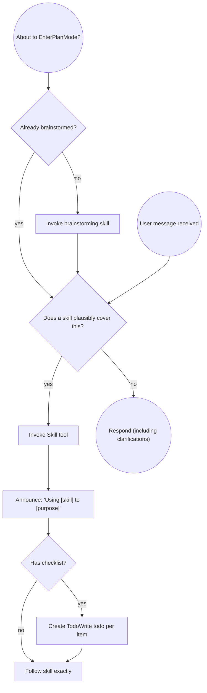

<SUBAGENT-STOP>
If you were dispatched as a subagent to execute a specific task, skip this skill.
</SUBAGENT-STOP>

## Instruction Priority

Chris-code skills override default system prompt behavior, but **user instructions always take precedence**:

1. **User's explicit instructions** (CLAUDE.md, direct requests) — highest priority
2. **Chris-code skills** — override default system behavior where they conflict
3. **Default system prompt** — lowest priority

If CLAUDE.md says "don't use TDD" and a skill says "always use TDD," follow the user's instructions. The user is in control.

## How to Access Skills

Use the `Skill` tool. When you invoke a skill, its content is loaded and presented to you: follow it directly. Never use the Read tool on skill files.

# Using Skills

## The Rule

**Before you respond or act, check whether a skill covers the task, and invoke it if one plausibly does.** That includes a clarifying question: the skill may say what to ask. If an invoked skill turns out not to fit the situation, drop it and carry on.

## When the Check Gets Skipped

| Thought | Reality |
|---------|---------|
| "This is just a question", or "too simple to need a skill" | A question or a small task can still have a skill. The check costs one look at the list. |
| "Let me explore or gather context first" | A skill may say how to explore. Check before you start. |
| "I remember what that skill says" | Skills change. Invoke it and read the current version. |

## Skill Priority

When multiple skills could apply, use this order:

1. **Process skills first** (brainstorming, debugging) - these determine HOW to approach the task
2. **Implementation skills second** (python-review, rust-review, bug-hunt) - these guide execution

"Let's build X" → brainstorming first, then implementation skills.
"Fix this bug" → debugging first, then domain-specific skills.

## Skill Types

**Rigid** (TDD, debugging): Follow exactly. Don't adapt away discipline.

**Flexible** (patterns): Adapt principles to context.

The skill itself tells you which.

## User Instructions

Instructions say WHAT, not HOW. "Add X" or "Fix Y" doesn't mean skip workflows.
